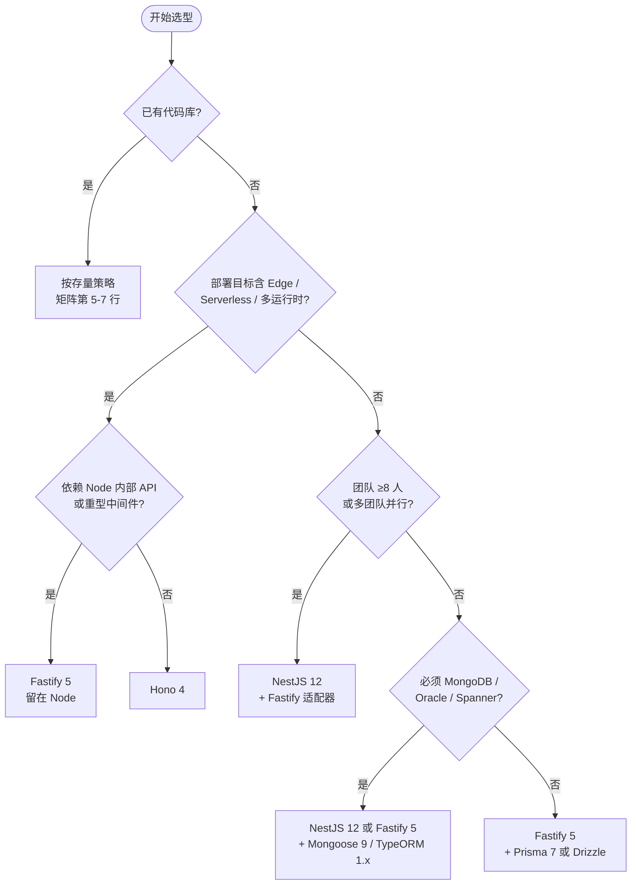

---
tags:
  - nodejs
  - 后端
  - 框架选型
  - 工具汇总
created: 2026-05-14
updated: 2026-10-23
verified: 2026-10-23
author: kuma
runtime: Node 22.22.2 (managed) / 26.4.0 (system)
---

# Node.js 后端框架选型与基础库对比

> **本文档的数据口径**：所有版本号、下载量、engines 均于 **2026-10-23** 通过 `npm view` 与 npm downloads API 实测获得；运行时能力在**本机 Node 22.22.2 与 26.4.0 上逐条跑通**。下载量为 2026-10-12 ~ 10-18 周的 npm 周下载量。基准测试引用 fastify.dev 官方基准（2026-10-12 更新）。
> 凡未标注"实测"的性能数字均为各项目官方/第三方基准，机器差异可达 2 倍，仅作相对参考。

---

## 本机环境快照（2026-10-23 实测）

| 项目 | 实测值 | 说明 |
|------|--------|------|
| **Node（managed，优先）** | `v22.22.2` | `C:\Users\kuma\.workbuddy\binaries\node\versions\22.22.2-6\node.exe`，工作流默认运行时 |
| **Node（system，兜底）** | `v26.4.0` | `C:\Program Files\nodejs\node.exe` |
| **npm** | `10.9.7` | 随 managed Node 22 提供（Node 26 自带 npm 11，PATH 上未生效） |
| **pnpm** | `10.12.1` | 本项目实际使用的包管理器 |
| **corepack** | `0.34.6` | 可用于锁定 pnpm 版本 |
| **yarn** | 未安装 | 不要假设 `yarn` 可用 |
| **Docker** | `29.4.3` | 已安装，容器化部署可行 |
| **npm registry** | `https://registry.npmmirror.com/` | **国内镜像，非官方源** |
| **OS** | Windows 10 专业版 | Git Bash 环境 |
| **全局 CLI** | `tsx` / `ts-node` / `pm2` 均未全局安装 | 均为按需 `pnpm dlx` / `npx` |

**两条环境约束，写代码前必须先确认：**

1. **Node 26.4.0 落后于 26.x 最新版**（官方文档已到 26.12.0）。落在 26.4.0 的 26.x 已在 2026-08 前后披露过可远程触发的 High/Critical 漏洞，系统级 Node 若要用于生产应补丁升级，而非停在 4.x 小版本。
2. **npm 走 npmmirror 镜像**：镜像同步通常滞后官方源数小时至数天，偶发 `latest` tag 落后甚至缺失版本。查新版本时若结果可疑，用 `npm view <pkg> version --registry=https://registry.npmjs.org/` 复核。

---

## Node.js 运行时基线

### 版本支持状态

| 版本 | 状态 | 维护截止 | 建议 |
|------|------|----------|------|
| **Node 20** | **已 EOL（2026-04-30）** | 已终止 | **不可用于新项目**，存量项目尽快迁移 |
| **Node 22** | 维护中 | 2027-04-30 | 存量项目可继续，新项目作为最低基线 |
| **Node 24** | Active LTS | 2028-04 | **新项目默认基线** |
| **Node 26** | Current | — | 可用，适合跟进新特性（本机已装 26.4.0） |

> **本文档的一个重要修正**：旧版本多处写"Node 20+"/"Node 20.6+"，但 Node 20 已于 2026-04-30 EOL、不再获得安全补丁。同时下方多个库已把 `engines` 抬到 `22.12+` 甚至 `22.18+`，Node 20 在事实上已不可选。**新项目请以 Node 22.12+（推荐 24 LTS）为基线。**

### 已稳定、可替代 npm 包的原生能力

旧版文档完全没有这一节。Node 平台近几年吞掉了大量"必装"基础库，选型时若不先查原生能力，很容易白装依赖。以下均已在本机实测通过：

| 原生能力 | 替代对象 | 本机实测结果 | 注意事项 |
|----------|----------|--------------|----------|
| **TypeScript 类型剥离**（`node app.ts`） | `ts-node` / `tsx` | **22.22.2 与 26.4.0 均可直接运行 `.ts`，无警告** | 只擦除类型，**不做类型检查**；`enum`、`namespace`（含运行时代码）、`parameter properties`、装饰器一律报错；忽略 `tsconfig.json`（`paths` 不可用）；`.tsx` 不支持。CI 必须另跑 `tsc --noEmit`。类型剥离在 v25.2/v24.12 起 Stable，`--experimental-transform-types` 已在 v26.0 移除 |
| **`--env-file`** | `dotenv` | 两版本均可用 | **暂不支持变量展开**：实测 `B=${A}-x` 会原样输出 `${A}-x`，需要展开时仍须 `dotenv-expand` |
| **`--env-file-if-exists`** | 带存在性判断的加载逻辑 | 两版本均可用 | 旧文档未提，**这是比 `--env-file` 更实用的默认选择**（缺失文件不报错） |
| **`node --run <script>`** | `npm run` | 两版本均可用 | 不启动 npm 进程，容器内更快、SIGTERM 转发更干净 |
| **`node --watch`** | `nodemon` | 26.4.0 实测可用（"Waiting for file changes…"） | 配合 `--watch-path` 限定目录 |
| **`node:test`** | Jest / Mocha（轻量场景） | 26.4.0 实测可用 | **旧文档说它"缺少 Watch 模式、快照"是错的**：`--watch` 与 `--test-update-snapshots` 都已存在，还有 `--test-coverage-*`、`--test-shard`、`--test-randomize`、`--test-isolation`。仍缺 UI 和生态插件 |
| **`node:sqlite`** | `better-sqlite3` | 26.4.0 稳定无警告；**22.22.2 仍打 ExperimentalWarning** | `DatabaseSync` 是**同步**实现，重并发会阻塞事件循环；只适合本地缓存 / CLI / 边缘查找表，不能替 PostgreSQL |
| **全局 `fetch` / `Response` / `Request`** | `node-fetch` | 稳定 | 简单请求无需 axios |
| **`require(esm)`** | 双包构建的兼容层 | 稳定（24/26） | 仅同步；ESM 依赖图含 **Top-Level Await** 时抛 `ERR_REQUIRE_ASYNC_MODULE` |
| **权限模型 `--permission`** | 沙箱库 | 26.4.0 实测可拦截未授权读取 | 粒度粗，且会被原生插件绕过；只能当纵深防御，不能替代容器隔离 |
| **`util.styleText` / `structuredClone` / `fs.glob` / `WebSocket`** | `chalk` / `lodash.clonedeep` / `glob` / `ws` | 稳定 | 简单场景够用，复杂 API 仍以库为主 |

**结论**：`dotenv`、`nodemon`、`node-fetch`、`ts-node` 这类库在 2026 年的新项目里已属"可删"。但仍需保留库的三处：**真实的类型检查（tsc）**、**变量展开**、**复杂 HTTP 客户端（拦截器/重试/取消）**。

---

## 主流框架对比

| 特性 | Express 5 | Fastify 5 | NestJS 12 | Hono 4 | Koa 3 | Egg 4 |
|------|-----------|-----------|-----------|--------|-------|-------|
| **作者/维护** | 社区 (OpenJS) | 社区 (NearForm, Matteo Collina) | Kamil Mysliwiec | 社区 (yusukebe) | 社区 (TJ 等) | 阿里 |
| **首次发布** | 2010 | 2016 | 2017 | 2022 | 2013 | 2016 |
| **当前版本** | **5.3.0**（2026-10-09） | **5.12.7**（2026-10-13） | **12.2.0**（2026-10-19） | **4.13.13**（2026-10-04） | **3.2.1**（2026-05-21） | **4.2.0**（2026-10-07） |
| **周下载量** | **8,745 万** | 933 万 | 938 万 | **4,524 万** | 418 万 | 1.6 万 |
| **Node 要求** | 18+ | 20+ | **20.19+ / 22.12+** | 16.9+（实际 18+） | **18+** | **22.18+** |
| **TypeScript** | 部分支持 (@types) | 内置一流支持 | 强制 TS | 原生 TS 设计 | 部分支持 (@types) | 部分支持 |
| **模块形态** | CJS（兼容 ESM 导入） | CJS + ESM 入口 | **全包 ESM**（CJS 项目靠 `require(esm)` 继续可用） | ESM | **CJS + ESM 双入口** | CJS/ESM 混用支持 |
| **架构风格** | 中间件（线性） | 中间件 + 插件 + JSON Schema | MVC + DI + 模块化 | 中间件（Web Standard） | 中间件（洋葱模型） | MVC + 约定优于配置 + Tegg 模块化 |
| **性能（官方基准）** | 62,054 req/s | **89,258 req/s** | 取决于适配器 | 84,885 req/s | 75,682 req/s | 中等 |
| **运行时** | Node.js | Node.js | Node.js | Node, Bun, Deno, CF Workers, Vercel Edge, Lambda | Node.js | Node.js |
| **插件生态** | 极其丰富（最大） | 丰富 | 丰富（模块系统） | 成长迅速 | 较丰富 | 丰富（国内） |
| **学习曲线** | 低 | 中 | 高（需 DI + ESM 知识） | 低 | 低-中 | 中-高 |
| **OpenAPI 文档** | 需第三方库 | 内置 (@fastify/swagger) | 需插件 | 需第三方 | 需第三方 | 需插件 |
| **适用场景** | 存量维护、简单 API | 高性能 API、微服务 | 大型企业级（8+ 人团队） | Edge/Serverless、跨运行时 | 中小型项目 | 大型企业级（国内） |

### 关于性能数字的更正

旧版文档写"Express ~10K、Fastify ~15-20K、Hono ~62K req/s"，这三组数字来自不同年代、不同机器，混在一张表里比较是错的（Hono 的 62K 恰好等于如今 Express 的水平）。**以 fastify.dev 官方基准（2026-10-12，单实例、同一台机器、同一套路由）为准的同一口径对比**：

| 框架 | req/s | 相对 Express |
|------|-------|--------------|
| Fastify 5.12.5 | 89,258 | **1.44×** |
| Hono 4.13.13 | 84,885 | 1.37× |
| H3 2.0.1 | 76,522 | 1.23× |
| Koa 3.2.1 | 75,682 | 1.22× |
| Express 5.2.1 | 62,054 | 1.00× |

**必须知道的现实**：这是 hello-world 基准。一旦加上一次 2-10ms 的数据库查询或外部 API 调用，框架开销全部被 I/O 淹没，三者的真实差距收缩到 **30%-50%**，通常小于一个缺失索引的代价。**框架性能不应该是 2026 年选型的主要变量**——生态、团队经验、部署目标是。

### 框架选型建议

- **Express 5（5.3.0）**：下载量仍是断层第一（8,745 万/周，约为 Fastify 的 9 倍），中间件与招聘池最大。v5 已原生支持 async 错误冒泡，"异步错误"这个历史痛点不再成立。**2026 年不再推荐新项目使用**，但存量项目升级到 5.x 是合理选择。
- **Fastify 5（5.12.7）**：官方基准吞吐第一，内置 JSON Schema 校验 + 序列化 + `@fastify/swagger` 自动文档，插件封装模型清晰。**2026 年新 Node.js API 的首选推荐**。
- **NestJS 12（12.2.0）**：**注意这是破坏性大版本，不是小升级**。要点：
  - 全部官方包改为 **ESM**，CommonJS 项目靠 `require(esm)` 继续运行；`nest new` 现在会询问 CJS 还是 ESM。
  - **Standard Schema 成为一等公民**：`@Body({ schema })` / `@Query` / `@Param` 可直接接 Zod / Valibot / ArkType，并新增 `StandardSchemaSerializerInterceptor` 做**响应序列化校验**（class-transformer 做不到的事）。class-validator 仍完整支持，但已不再是唯一路径。
  - `@nestjs/config` 从 Joi 专用校验改为 Standard Schema，**继续用 Joi 必须升到 Joi 18+**，且库特定配置要挪到 `validationOptions.libraryOptions`。
  - 新增 `@nestjs/observe`（`instrument` 选项接入请求生命周期，可归因到 controller/guard/provider），以及内置 cookies / CSRF / 安全响应头（v12.1）。
  - 工具链：Rspack 取代 webpack（monorepo 默认）、oxlint 取代 ESLint、ESM 项目默认 Vitest（CJS 仍 Jest）、`nest upgrade` 自动迁移、TypeScript 抬到 v6。
  - 破坏点：**生命周期钩子改为按组件层级顺序调用**；NATS 换 `@nats-io/transport-node`；GraphQL 移除 `subscriptions-transport-ws`、GraphiQL 取代 Playground。
  - 8+ 人团队的默认选择。可切 Express / Fastify 适配器。
- **Hono 4（4.13.13）**：已不是"新星"而是主流（4,524 万/周）。基于 Web Standard，一套代码跑 Node/Bun/Deno/Workers/Edge。核心 ~14KB，RPC 客户端端到端类型安全。**在 Node 上并不比 Fastify 快（84.9K vs 89.3K）**，它的价值在跨运行时与体积，不在"Node 上的极致性能"。
- **Koa（3.2.1）**：已发布 v3（要求 Node 18+，同时提供 CJS 与 ESM 入口）。洋葱模型仍优雅，但生态活跃度持续下行，新项目被 Hono / Fastify 取代。
- **Egg（4.2.0）**：需要 **Node 22.18+**。v4 引入 Tegg 模块化 + 依赖注入 + 生命周期、Vitest 迁移、utoo 工具链、bundle/启动快照、cluster 部署。国内大型团队仍可用，但**周下载量仅 1.6 万**（NestJS 的 1/580），社区规模与 NestJS 不在一个量级，新项目默认不选。

### 2026 选型决策矩阵

> 上一节按**框架**维度列单点事实（版本、下载量、破坏性变更）；本节按**场景**维度看取舍，回答三个问题：我这个团队该选谁、要付出什么代价、什么情况下**不该**选它。

#### 一、先定这四个变量，性能排第五

选型失败的常见原因不是"选错框架"，而是**把权重排错了**。按实际影响力排序：

| 权重 | 变量 | 为什么它左右结论 | 本文档的可验证依据 |
|:---:|---|---|---|
| **1** | **存量资产** | 已有 Express / NestJS 代码库时，重写成本几乎总大于收益 | 迁移风险来自测试覆盖与中间件兼容，不是框架本身 |
| **2** | **团队规模与流动率** | ≥8 人、或人员流动频繁 → 需要框架**强制**约束而非"约定" | NestJS DI/模块化 vs Fastify 自由组合，差异在此显现 |
| **3** | **部署目标** | Node 长驻进程 / Serverless / Edge 直接决定候选集 | Hono 之外的框架都只能跑 Node |
| **4** | **数据库与方言** | MongoDB / Oracle / Spanner / HANA 会反向锁定 ORM，再锁定框架生态 | 见第一章 ORM 表：Drizzle 不支持 MongoDB 与 SQL Server |
| **5** | ~~峰值吞吐~~ | hello-world 差 1.44×，加一次 DB 查询后只剩 30-50% | fastify.dev 官方基准（2026-10-12） |

> **一句话**：吞吐量在第 5 位，且真实业务中通常小于"一个缺失索引"的代价。若你的选型会议在争论 req/s，多半是在优化错误的东西。

#### 二、主决策矩阵

| # | 场景 | 推荐 | 关键前提（不满足就别选） | 明确的反例 | 你付出的代价 |
|:-:|---|---|---|---|---|
| 1 | **中小团队（2-7 人）新 Node API** | **Fastify 5** | 团队接受 JSON Schema / TypeBox 的写法 | NestJS（样板压过收益）、Egg 4（生态太小） | 分层、DI、目录规范要自己定，无框架兜底 |
| 2 | **大型团队（8+）/ 多团队并行** | **NestJS 12 + `@nestjs/platform-fastify` 12.2.0** | 有架构负责人能主持 ESM 迁移 | Express（无约束，半年后各写一套） | 启动更慢、样板代码多、学习曲线陡、部分 Express 中间件不可用 |
| 3 | **Edge / Serverless / 一套代码多运行时** | **Hono 4** | 部署目标确实含 Workers/Bun/Deno，或冷启动是硬指标 | Fastify / Express（Node only，无法迁移） | 生态最窄、Node 内部 API 不可用、需 `@hono/node-server` 才能在 Node 跑 |
| 4 | **BFF / API 网关 / 聚合层** | **Fastify 5**（纯 Node）或 **Hono 4**（跨运行时） | 需要 schema 校验 + 序列化提速 + 自动 OpenAPI | Express（手写校验与文档） | 上游服务契约变更时需同步 schema |
| 5 | **存量 Express 项目** | **留在 Express，升到 5.3.0** | 中间件依赖重、测试非全覆盖 | 为"性能"重写（收益 1.44×，成本全量回归） | 长期停在"够用但不先进"，生态红利减少 |
| 6 | **存量 NestJS 11** | **`nest upgrade --dry-run` 后再升 12** | 能接受 Joi 18 / 生命周期顺序 / ESM 三项连带改动 | 无条件直接升（钩子顺序变化会静默改变初始化行为） | 迁移窗口 + 回归测试成本 |
| 7 | **存量 Egg 3** | **先评估，再决定升 4 或迁 NestJS** | 运行时能上到 Node 22.18+ | 为了"跟版本"而升（测试工具链 Mocha→Vitest 同时变） | Node 门槛 + 工具链整体迁移 |
| 8 | **国内阿里系 / 强约定团队** | **Egg 4**（谨慎） | 已有 Egg 资产或团队熟悉阿里体系 | 新团队从零选 Egg（周下载 1.6 万，社区规模不足以支撑招聘与排障） | 社区小、问题靠读源码 |
| 9 | **CLI / 内部工具 / 小服务** | **Node 原生**（`http` 或 Hono + `node:test` + `node:sqlite`） | 无复杂鉴权与多租户需求 | 上 NestJS（杀鸡用牛刀） | 无类型检查（CI 补 `tsc --noEmit`）、无生态插件 |
| 10 | **必须用 MongoDB** | 框架任选，**ORM 锁 Mongoose 9.11.3** | —— | **Drizzle（不支持 MongoDB）**、Kysely（无 ODM 能力） | 失去 Prisma/Drizzle 的类型推断体验 |
| 11 | **必须支持 Oracle / Spanner / HANA** | 框架任选，**ORM 锁 TypeORM 1.1.2** | 能接受 TypeORM 的装饰器风格 | Prisma（不支持 Oracle/Spanner/HANA）、Drizzle（同左） | 放弃 Prisma 的迁移工具与 DX |
| 12 | **需要多租户 / 组织 / MFA / Passkeys** | 框架任选，**认证层用 better-auth 1.7.12** | —— | Auth.js v5（仍是 beta）、Lucia（已废弃） | 相对新的生态，需自行验证边界场景 |

#### 三、逐场景的优劣与推荐理由

**① 中小团队新 API → Fastify 5（5.12.7）**

- **为什么是它**：唯一同时满足"吞吐最高 + 内置校验/序列化/OpenAPI + 依赖极轻"的 Node 框架。JSON Schema 在路由声明处一次定义，请求校验、响应序列化（`fast-json-stringify`）、Swagger 文档三件事全部自动生成——这三件事在 Express 里要装 3-4 个包并手写胶水。
- **优势**：官方基准 89,258 req/s（Express 的 1.44×）；插件封装（encapsulation）让模块边界天然清晰；`@fastify/swagger` 9.9.2 直接出 OpenAPI。
- **代价**：**没有 DI 容器**。业务变大后，服务之间的依赖靠手动组装或引入 `awilix` 之类的第三方方案；目录分层、错误处理规范都需团队自建。JSON Schema 的写法比 Zod 啰嗦（可用 TypeBox 缓解）。
- **什么时候该换成 NestJS**：团队 ≥8 人、或开始出现"同一个功能三种写法"时。这不是性能问题，是**协作成本**问题。

**② 大型团队 / 多团队并行 → NestJS 12（12.2.0）**

- **为什么是它**：DI + 模块化把"约定"变成"框架强制"。新人入职照模块写就不会跑偏，跨模块依赖必须在 module 里显式声明，这是 Express/Fastify 给不了的。v12 又补了两块过去必须外挂的能力：**Standard Schema 校验/序列化**（Zod 直进 `@Body({schema})`，还能校验响应体）与 **`@nestjs/observe` 原生可观测**（可按 controller/guard/provider 归因）。
- **优势**：生态最完整的"框架级"方案（gRPC/Kafka/队列/GraphQL/微服务全内置）；可切 Fastify 适配器；`nest upgrade` 能自动完成大部分迁移。
- **代价**：
  - **吞吐不是最优**：Fastify 适配器引入抽象层，实际介于原生 Fastify 与 Express 之间（官方无统一基准，随路由复杂度浮动）。
  - **Express 中间件不通用**：走 Fastify 适配器时，Express 专用中间件需 `@fastify/middie` 兼容层，部分直接不可用——这是"为了性能换适配器"最常踩的坑。
  - **v12 迁移是真活儿**：ESM、Joi 18、生命周期钩子按层级调用，三者都可能静默改变运行时行为。
- **建议**：新项目直接 `nest new` 选 ESM + Vitest；存量项目先 `--dry-run` 评估，别把升级当例行 patch。

**③ Edge / 多运行时 → Hono 4（4.13.13）**

- **为什么是它**：基于 Web Standard（Fetch API），同一份代码在 Node / Bun / Deno / Workers / Vercel Edge 上不改业务逻辑。核心 ~14KB 直接影响冷启动与打包上限（Workers 免费套餐对 gzip 后体积有 1MiB 硬限制），在 Edge 场景下体积是**准入条件**而非优化项。RPC 客户端让前后端共享类型，等价于"轻量版 tRPC"。
- **优势**：4,524 万/周（已是主流而非实验品）；路由用 Radix Trie / 预编译，性能与 Fastify 同级（84.9K vs 89.3K）。
- **代价（必须诚实说）**：**在纯 Node 场景它没有性能优势**。若你不打算离开 Node，选 Hono 的唯一理由是它更轻、API 更现代，而不是"更快"。生态最窄——依赖 Node 内部 API 的包（部分日志、监控、原生驱动）在 Workers 上不可用，可能被迫维护两套路径。
- **边界**：部署目标里**没有** Edge/Serverless 时，优先 Fastify。

**④ 存量 Express → 升 5.3.0，不要换框架**

- **为什么**：Express 5 已原生支持 async 错误冒泡，历史上"必须换 Koa/Fastify 才能优雅处理异步错误"的最大理由消失了。8,745 万/周意味着任何中间件问题都能搜到答案，这是新人上手成本最低的选项。
- **优势**：零重写；中间件与招聘池最大；v5 修掉了 v4 的长期痛点。
- **代价**：长期停在"够用但不先进"——没有内置校验/文档/序列化，必须靠第三方拼装。
- **反例**：为 1.44× 吞吐重写 Express 服务是典型的负收益工程。真实的性能瓶颈通常在 DB 查询与 N+1，先 profile 再谈框架。

**⑤ 存量 NestJS 11 → 谨慎升 12**

- **为什么值得升**：ESM 让依赖图更干净；Standard Schema 把校验与序列化解耦出 class-validator/class-transformer；`@nestjs/observe` 省掉一层 APM 胶水；国内社区与文档会逐步只覆盖 v12。
- **代价与风险**：**生命周期钩子改为按组件层级顺序调用**——这条最危险，它会静默改变 `onModuleInit` 之间的依赖顺序，测试不一定能发现；`@nestjs/config` 换 Standard Schema 后，继续用 Joi 必须 ≥18 且配置要挪位置；NATS 客户端换包、GraphQL 移除 `subscriptions-transport-ws`。
- **建议路径**：`nest upgrade --dry-run` → 读变更 → 分支上升级 → **重点回归模块初始化顺序与配置校验** → 再合入。

**⑥ 存量 Egg 3 → 先算清账再动**

- **为什么犹豫**：Egg 4（4.2.0）本身进步不小（Tegg 模块化 + DI、Vitest、bundle/启动快照），但它要求 **Node 22.18+**，且测试工具链从 Mocha 迁到 Vitest、构建迁到 utoo——这是"运行时 + 工具链 + 测试"三件事同时变。
- **代价**：周下载仅 1.6 万，遇到问题基本靠读源码；招聘市场上 Egg 经验远少于 NestJS。
- **建议**：有强阿里体系背景就升；否则评估"迁 NestJS"的长期成本可能更划算。

#### 四、决策流程

#### 五、反模式清单（比"推荐什么"更有用）

| 反模式 | 为什么错 | 正确做法 |
|---|---|---|
| 为性能从 Express 迁 Fastify/Hono | hello-world 1.44×，真实业务 30-50%，通常小于一个索引的收益 | 先 profile；瓶颈多在 DB、N+1、序列化 |
| 2-3 人团队上 NestJS | 模块/DI/装饰器的样板成本压过协作收益 | Fastify 或 Express + 自建轻分层 |
| 8+ 人团队用 Express 裸写 | 无强制约束，半年后同一功能多种写法 | NestJS 12，或至少建立强约定 + 代码评审规则 |
| 纯 Node 场景为"跨运行时"选 Hono | 你永远用不到那个优势，却承担了最窄的生态 | Fastify 5 |
| 直接用 `npm i prisma` 上生产 | `latest` tag 现在指向 `8.0.0-rc.24` | 显式锁 `prisma@7`，8 正式版发布后再评估 |
| 新项目选 Auth.js v5 | v5 从未发稳定版，且 2026-07 有 CVSS 9.1 fail-open | better-auth 1.7.12 |
| 为 MongoDB 选 Drizzle | Drizzle 不支持 MongoDB | Mongoose 9 |
| 用 `node:sqlite` 顶 PostgreSQL | `DatabaseSync` 同步执行，会阻塞事件循环 | 仅用于本地缓存/CLI；OLTP 用 PG |

#### 六、推荐组合搭配

| 场景 | 框架 | ORM | 校验 | 日志 | 测试 |
|---|---|---|---|---|---|
| 中小 API | Fastify 5 | Prisma 7 | Zod 4 | Pino 10 | Vitest 5 |
| 企业级 | NestJS 12（Fastify 适配器） | Prisma 7 | Zod 4 / class-validator | Pino 10 | Vitest 5 |
| Edge | Hono 4 | Drizzle 0.45（锁版本） | Valibot 1.5 | LogTape 2 | Vitest 5 |
| 高吞吐 / 网关 | Fastify 5 | Drizzle 或 Kysely | TypeBox | Pino 10 | Vitest 5 |
| MongoDB 服务 | NestJS 12 / Fastify 5 | Mongoose 9 | Zod 4 | Pino 10 | Vitest 5 |
| 原生极简 | 原生 `http` / Hono | `node:sqlite` | 手写 / Zod | `console` + 结构化 JSON | `node:test` |

> **组合的唯一硬约束**：**Prisma 7 必须配 driver adapter**（`@prisma/adapter-pg` 7.10.1、`@prisma/adapter-better-sqlite3` 7.10.1），且只输出 ESM；**Drizzle 无 MongoDB / SQL Server 支持**；**NestJS 12 + Fastify 适配器**要用 `@nestjs/platform-fastify` 12.2.0，且 Express 专属中间件需 `@fastify/middie`。

---

## 常用基础库对比

### ORM / 数据库操作

| 库 | 类型 | TS | 支持数据库 | 周下载量 | 特点 |
|---|------|----|-----------|----------|------|
| **Prisma 7**（7.10.1，8 在 RC） | ORM | 一流 | PostgreSQL, MySQL, MariaDB, SQLite, SQL Server, CockroachDB, MongoDB | **1,170 万** | **架构已换血**：v7 移除 Rust 查询引擎，改为 TypeScript 查询编译器，**必须配 driver adapter**（如 `@prisma/adapter-pg`），**仅输出 ESM**，默认 generator 从 `prisma-client-js` 换成 `prisma-client`（必须显式 `output`） |
| **Drizzle ORM**（0.45.4，1.0 在 rc） | ORM / Query Builder | 一流（无代码生成） | PostgreSQL, MySQL, SQLite, Turso, D1, Bun SQLite | **1,834 万** | **下载量已反超 Prisma**。SQL-like 语法、零代码生成、无二进制、Edge 原生。**注意：1.0 仍未正式发布**（`latest` 是 0.45.x，1.0 停在 rc.5），API 仍可能变动 |
| **Kysely**（0.29.7） | Query Builder | 优秀 | PostgreSQL, MySQL, SQLite, MSSQL | 1,278 万 | 纯类型安全 Query Builder，最接近原生 SQL。注意仍处 0.x |
| **TypeORM**（1.1.2） | ORM | 好 | MySQL, PostgreSQL, SQLite, MSSQL, Oracle, SAP HANA, Spanner, MongoDB | 285 万 | **结论已反转**：2024 年底换维护者后强势复兴，2026 年发布 **1.0**（近五年首个大版本）。Node 20+/ES2023；`Connection` 彻底移除改 `DataSource`；`findOneById`→`findOneBy`；`where` 中 null/undefined 默认抛错；`sqlite3`→`better-sqlite3`；提供 `@typeorm/codemod` |
| **Mongoose**（9.11.3） | ODM | 好 | MongoDB | 376 万 | MongoDB 专属 ODM。**当前是 v9**，MongoDB 项目仍首选 |
| **Sequelize**（6.37.8） | ORM | 一般 | MySQL, PostgreSQL, SQLite, MSSQL | 153 万 | 老牌，方言最广（Snowflake/DB2/Oracle），但 TS 与 API 设计落后；v7 重写在 alpha |
| **Knex.js**（3.3.0） | Query Builder | 一般 | PostgreSQL, MySQL, SQLite, MSSQL | 298 万 | 老牌、灵活度最高，可配 Objection.js（4.2.0）。新项目更推荐 Kysely |

**推荐：**
- 大多数团队首选 **Prisma 7**（DX + 迁移工具最强）。**升级前务必确认**：driver adapter、ESM、`output` 配置三件事都要改，老教程基本失效。
- **Prisma 8 已是 RC**（`latest` tag 当前就指向 `8.0.0-rc.24`，容易误装）：全 TypeScript 实现、tree-shakeable、无原生二进制、结果以 async iterable 流式返回、取消全部 preview 特性、转为扩展架构。Prisma 7 在 8 发布后仍支持 18 个月。**生产环境在 8 正式版发布前请显式安装 `prisma@7`，不要裸装 `prisma`。**
- SQL 优先 / Edge 部署首选 **Drizzle**，但请锁版本，1.0 尚未落地。
- 精细 SQL 控制首选 **Kysely**；MongoDB 首选 **Mongoose 9**。
- **TypeORM 可以重新考虑了**：如果你要的是"成熟 + 广方言（Spanner/Oracle/HANA）+ 装饰器风格"，TypeORM 1.x 已恢复健康维护；只有追求最新 DX 时才让位 Prisma/Drizzle。

### 数据验证

| 库 | 版本 | 特点 |
|---|------|------|
| **Zod** | **4.6.7** | 事实标准，**2.07 亿/周**（比第二名高一个数量级）。v4 相比 v3 大幅提速、体积显著下降。生态最大（tRPC / Hono / React Hook Form / Drizzle 均集成） |
| **Valibot** | 1.5.0 | 模块化 / 函数式，按需导入极致 Tree-Shaking，简单校验 <1KB。前端表单与 Edge 首选。1,313 万/周 |
| **TypeBox** | 0.34.52 | JSON Schema 原生，配合 Ajv 编译后运行时最快；Fastify 官方推荐的 type provider，OpenAPI 场景最优。6,694 万/周（多为 Fastify 传递依赖） |
| **ArkType** | 2.2.9 | TS 语法即校验，类型推断最精准 |
| **class-validator** | 0.15.1 | 仍是 0.x。**NestJS 12 起不再是唯一路径**——Standard Schema 让 Zod/Valibot/ArkType 直接进 `@Body({ schema })`，class-validator 保留但非必需 |
| **Ajv** | 8.20.0 | JSON Schema 编译验证，Fastify 内置，高吞吐场景首选 |
| **Joi** | **18.3.0** | 功能强大，TS 支持仍弱。**但 Joi 18 实现了 Standard Schema**——NestJS 12 的 `@nestjs/config` 若继续用 Joi 必须 ≥18 |
| **Yup** | 1.7.1 | 类 Joi API，前端居多；新项目建议 Zod/Valibot |

**推荐**：通用 **Zod 4**；前端/Edge **Valibot**；API/OpenAPI **TypeBox**；**NestJS 12 起优先 Standard Schema（Zod/Valibot/ArkType）+ `StandardSchemaValidationPipe`**，需要装饰器生态时才用 class-validator。

### 认证与授权

| 库 | 版本 | 特点 |
|---|------|------|
| **better-auth** | **1.7.12** | **新项目首选**。TS 原生，插件架构（Passkeys/MFA/OAuth/Magic Links/Organization/Rate Limit），适配 Next.js / SvelteKit / Nuxt / Hono / Express。**周下载 780 万**（旧文档写的 50 万→500 万已严重滞后） |
| **Auth.js**（next-auth） | `latest` = **4.24.15**；v5 = `5.0.0-beta.32` | **必须澄清：v5 从未发布稳定版**，`latest` tag 仍是 v4（维护模式），官方迁移文档至今让你装 `next-auth@beta`；`@auth/core` 停在 0.41.3（未 1.0）。**Auth.js 项目已于 2025-09 并入 Better Auth**，维护团队公开建议新项目用 Better Auth。2026-07 披露过仅影响 v5 beta 的 CVSS 9.1 fail-open 认证绕过。周下载 399 万 |
| **Passport.js** | 0.7.0 | 500+ 策略，Express 时代标准。维护低频但稳定，存量项目保持不迁移 |
| **jsonwebtoken** | 9.0.3 | 底层 JWT 签发/验证，DIY 场景基础库，需自建 refresh/黑名单 |
| **jose** | 6.2.13 | 现代 JWT/JWS/JWE 实现，支持 Edge，**推荐替代 jsonwebtoken** |
| **bcrypt / bcryptjs** | 6.0.0 / 3.0.3 | 密码哈希标准方案；`bcrypt` 更快，`bcryptjs` 纯 JS 免编译 |
| **Lucia** | 3.2.2（已废弃） | **npm 包与 Drizzle adapter 均已 deprecated**，只剩文档作为"自己实现 session"的学习范式 |

**推荐**：新项目 **better-auth**；**不要为新项目选 Auth.js v5**（仍是 beta 且有过 fail-open 记录），现存 NextAuth/Auth.js 项目按兵不动即可；简单 DIY 场景 **jose + bcrypt**；存量 Express **Passport**。

### 日志

| 库 | 版本 | 特点 |
|---|------|------|
| **Pino** | **10.4.0** | **新项目默认**。**3,267 万/周，已是 Winston 的 2.2 倍**（旧文档"Winston 下载量最高、Pino 在追赶"已完全反转）。Worker Thread 传输不阻塞事件循环，Fastify 默认日志库 |
| **Winston** | 3.19.0 | 1,514 万/周。传输最多（80+）、格式灵活。存量项目无需迁移 |
| **pino-http** | 11.0.0 | HTTP 日志中间件，替代 Morgan，366 万/周 |
| **Morgan** | 1.12.1 | Express 常用请求日志，轻量。新项目建议 pino-http |
| **LogTape** | 2.4.2 | 零依赖、Node/浏览器/Edge 全运行时、Tree-Shakeable。适合库作者 |
| **log4js** | 6.9.1 | 类 log4j 配置，国内老项目多，新项目不推荐 |

**推荐**：**Pino 10**（性能优先）；Winston 存量不迁移；跨运行时 **LogTape 2**。

### HTTP 客户端

| 库 | 版本 | 特点 |
|---|------|------|
| **Axios** | **1.20.0** | 6,656 万/周。拦截器、自动 JSON、取消请求，生态最成熟 |
| **undici** | **8.12.3** | 1.33 亿/周（含 Node 内置依赖）。Node 官方团队维护，即 `fetch` 的底层实现；需要连接池/`ProxyAgent`/更高性能时直接用 undici |
| **ofetch** | 1.5.1 | 基于 fetch，轻量，unjs 生态（Nuxt 默认） |
| **got** | 16.1.0 | 功能最丰富：hooks、重试、流式。注意 v12+ 起为纯 ESM |

**推荐**：需要拦截器/复杂场景 **Axios**；**多数场景直接用全局 `fetch` 即可**（Node 22/26 均稳定）；要连接池或极致性能用 **undici**；Nuxt/unjs 体系用 **ofetch**。

### 配置管理

| 方案 | 特点 |
|------|------|
| **Node `--env-file` / `--env-file-if-exists`** | **内置，零依赖，实测两版本均可用**。**不支持变量展开**（实测 `${A}-x` 原样输出）。生产/CI 优先用 `--env-file-if-exists` |
| **dotenv** | 18.0.9（2026-10-22）。最轻量 .env 加载，需变量展开时配 `dotenv-expand`；也提供 CLI |
| **dotenv + Zod** | **TS 项目标准方案**：加载 + 校验 + 类型推导。Zod 4 可直接作为 Standard Schema 喂给 NestJS 12 |
| **@nestjs/config** | 12.0.1。**v12 起改用 Standard Schema 校验**，`validationSchema` 可接 Zod/Valibot；继续用 Joi 需 ≥18，且库特定配置放 `validationOptions.libraryOptions` |
| **convict** | 6.2.5（2026-03 更新）。schema 定义 + 类型校验 + 环境变量映射 + CLI 参数，仍活跃。复杂配置需求首选 |
| **node-config** | 5.0.1。多环境配置文件组织（default/production.json），传统方案 |

**推荐**：简单场景 **`--env-file-if-exists`**（零依赖）；TS 项目 **dotenv + Zod**；NestJS 12 **@nestjs/config + Standard Schema**；复杂配置 **convict**。

### 队列 / 消息

| 库 | 版本 | 特点 |
|---|------|------|
| **BullMQ** | **6.4.0** | 后台任务首选。**v6 是破坏性大版本**：引入 `IQueueBackend` 可插拔后端，**新增 PostgreSQL 后端**（不想多运维一个 Redis 时很有价值）；`ioredis` 改为**可选 peer 依赖，必须自己装**；**移除旧版 repeatable job**（`repeat` 选项、`Repeat` 类、`getRepeatableJobs()` 全删）→ 迁移到 **Job Schedulers**（`upsertJobScheduler`）；`Queue#client` / `Worker#blockingClient` 移除，改 `getBackend()`；`Worker#resume()` 变 async；`debounce` → deduplication |
| **KafkaJS** | 2.2.4 | Kafka 客户端，高吞吐事件流。**注意：自 2022 年后基本停更**，长期项目需评估替代（如 `@confluentinc/kafka-javascript`） |
| **amqplib** | 2.2.0 | AMQP/RabbitMQ 客户端，Exchange/Queue 精确路由 |
| **Bee-Queue** | 2.0.0 | 轻量 Redis 队列，API 简洁，功能少于 BullMQ |
| **Agenda** | 6.2.6 | MongoDB 驱动任务调度，适合已在用 MongoDB 的项目 |

**推荐**：后台任务 **BullMQ 6**（已用 Postgres 就别再拉 Redis）；事件流 **Kafka**（新项目慎选 KafkaJS）；复杂路由 **RabbitMQ/amqplib**。

### 测试

| 库 | 版本 | 类型 | 特点 |
|---|------|------|------|
| **Vitest** | **5.0.5** | 测试框架 | **新项目默认**。**7,753 万/周**。v5（2026-09-03）整体提速 8%-53%，新增 `vitest doctor`、Browser Mode Trace View、`vi.when` 按参数 mock、嵌套 projects。**engines：Node `^22.12 \|\| ^24 \|\| >=26` + Vite ≥6.4**——本机 22.22.2 满足，Node 20 不满足 |
| **Jest** | 30.5.2 | 测试框架 | 2,579 万/周。Meta 维护，快照/覆盖率/Mock 一站齐全，v30 支持原生 ESM。适合存量项目与 **React Native**（Vitest 不支持 RN） |
| **Playwright** | 1.64.1 | E2E | E2E 绝对领先：多浏览器、自动等待、Trace Viewer |
| **Supertest** | 7.3.1 | HTTP 集成测试 | 配合测试框架做接口集成测试，轻量实用 |
| **node:test** | 内置 | 内置 | Node 22/26 均已稳定，**实测支持 `--watch`、快照（`--test-update-snapshots`）、覆盖率、`--test-shard`、随机顺序**。缺 UI 与生态插件，适合库/CLI |

**推荐**：单元测试 **Vitest 5**；React Native **Jest**；E2E **Playwright**；工具库/CLI **node:test**；HTTP 测试 **Supertest**。

### 进程管理与部署

| 方案 | 本机状态 | 特点 |
|------|----------|------|
| **Docker / Compose** | **已安装 29.4.3** | **现代部署标准**：环境一致、CI/CD 天然集成、水平扩展。配合 K8s/ECS 编排 |
| **PM2** | 未全局安装（7.1.0） | 传统 VPS 首选：自动重启、零停机重载、负载均衡、日志。单机少量服务器场景仍够用 |
| **Cluster（内置）** | — | `node:cluster`，通常由 PM2 Cluster Mode 代劳 |
| **Docker + PM2** | — | 容器内跑 Cluster Mode 吃满多核。与"一容器一进程"原则冲突，仅在复杂场景使用 |
| **`node --run`（部署脚本）** | 实测可用 | 容器内替代 `npm run`，少一个进程、信号转发更干净 |

**推荐**：**Docker**（本机已具备）；传统 VPS 用 **PM2**；单机单应用容器内直接 `node dist/index.js` 即可。

### 可观测性【新增】

旧版文档没有这一节，但 2026 年这是后端选型绕不开的一块。

| 方案 | 特点 |
|------|------|
| **OpenTelemetry（`@opentelemetry/*`）** | 跨语言事实标准，trace/metrics/logs 统一。代价是配置与体积，Node 侧需注意 ESM 下的 instrument 顺序 |
| **`@nestjs/observe`**（NestJS 12 内置） | 接在 Nest 请求生命周期上（`instrument` 选项），可按 controller/guard/interceptor/provider/queue consumer 归因；HTTP/GraphQL/gRPC/微服务/队列/cron 自动埋点。**但仅限 NestJS，且为 1.x 初期版本**，跨栈关联仍需外部 APM |
| **Pino + pino-http** | 结构化日志是最低成本的"可观测"起点，先做日志再谈 APM |

**推荐**：起点用 **Pino 结构化日志 + 请求 ID**；需要跨服务追踪再上 **OpenTelemetry**；NestJS 团队可试 `@nestjs/observe`，但别把它当唯一 APM。

---

## 2026 推荐技术栈组合

### 方案 A：快速起步（中小型项目 / 创业团队）

> **Fastify 5 + Prisma 7 + Zod 4 + Pino 10 + 全局 fetch（或 Axios）+ `--env-file-if-exists` + BullMQ 6 + Vitest 5 + Docker**
>
> 基线 Node **22.12+（推荐 24 LTS）**；包管理统一 **pnpm**。

### 方案 B：企业级标准（大型项目 / 多团队）

> **NestJS 12（Fastify 适配器） + Prisma 7 + Standard Schema（Zod 4，或 class-validator） + Pino 10 + Axios + @nestjs/config 12 + BullMQ 6 + Vitest 5 + Docker / K8s**
>
> **升级提醒**：ESM 运行时、Joi 18、生命周期钩子顺序、`nest upgrade` 迁移。

### 方案 C：Edge / Serverless（跨运行时 / 全球低延迟）

> **Hono 4 + Drizzle 0.45（锁版本，1.0 未发布） + Valibot 1.5 + LogTape 2（或 Pino） + ofetch + BullMQ 6（Redis 后端） + Vitest 5**

### 方案 D：轻量高性能 API（微服务 / API 网关）

> **Fastify 5 + Drizzle / Kysely + TypeBox + Pino 10 + undici 8 + `--env-file-if-exists` + BullMQ 6（PostgreSQL 后端）+ Vitest 5 + Docker / K8s**

### 方案 E：Node 原生极简（CLI / 内部工具 / 小服务）【新增】

> **原生 `http` 或 Hono + `node:sqlite` + `node:test` + `node --run` + `node --watch` + 原生 TS 类型剥离**
>
> 依赖数接近零。代价：无类型检查（CI 补 `tsc --noEmit`）、`node:sqlite` 同步阻塞、无生态插件。

---

> **选题建议**：方案 A（Fastify + Prisma）适合大多数新项目；方案 B（NestJS 12）适合需要强制架构统一的大型团队；方案 C（Hono）适合拥抱现代运行时的前沿项目；方案 E 适合"能不装依赖就不装"的工具型场景。

---

## 附录 A：逐项复核记录（2026-10-23）

复核方式：`npm view` 取真实版本与 `engines` → npm downloads API 取周下载量 → 在本机 Node 22.22.2 / 26.4.0 上实跑内置能力 → 官方 changelog / 发布说明核对破坏性变更。

**判定图例**：`过时` = 版本/数据陈旧 · `错误` = 与事实相反 · `缺失` = 应写未写 · `部分偏差` = 大方向对但数字/表述需修 · `准确` = 无需改动

### A1. 运行时与框架

| 项目 | 文档原描述 | 实测现状 | 判定 |
|------|-----------|----------|------|
| Node 运行时 | 多处"Node 20+"、"Node 20.6+ 内置" | Node 20 **已于 2026-04-30 EOL**；本机 22.22.2 / 26.4.0 | 过时 |
| Node 原生能力 | 未提及 | TS 类型剥离、`--env-file-if-exists`、`node:sqlite`、`--run`、`--watch`、`node:test`、权限模型均已稳定可用 | **缺失** |
| Express | v5.1 (2024) | **5.3.0**（2026-10-09），8,745 万/周 | 过时 |
| Fastify | v5.x (2024)、"15-20K req/s" | **5.12.7**（2026-10-13），官方基准 **89,258 req/s** | 过时 |
| NestJS | **NestJS 11**、v11 (2025)、"v11 对齐 Express 5/Fastify 5" | **12.2.0**（2026-10-19，v12.0 于 2026-08-27 发布）；ESM 全包、Standard Schema、`@nestjs/observe`、Node 20.19+/22.12+ | **错误** |
| Hono | v4.x (2025)、"~62K req/s"、"最值得关注的新星" | **4.13.13**，官方基准 **84,885 req/s**，**4,524 万/周**——已是主流而非新星 | 部分偏差 |
| Koa | v2.x | **3.2.1**（2026-05-21），要求 Node 18+，CJS+ESM 双入口 | 过时 |
| Egg.js | v3.x | **4.2.0**（2026-10-07），要求 **Node 22.18+**，Tegg 模块化 + DI | 过时 |
| 性能对比 | Express ~10K / Fastify 15-20K / Hono 62K，"Fastify 快 2-3 倍" | 同一套官方基准：Fastify 89.3K / Hono 84.9K / Koa 75.7K / Express 62.1K，**Fastify 仅 1.44× Express** | **错误** |
| Hono 在 Node 的性能定位 | 暗示 Node 上最快 | 官方基准中 **Fastify 略快于 Hono**；Hono 优势在跨运行时/体积 | 部分偏差 |
| NestJS 验证选型 | "NestJS 场景 class-validator" | v12 起 Standard Schema 一等公民，Zod/Valibot/ArkType 可直接进 `@Body({ schema })` | 缺失 |

### A2. ORM

| 项目 | 文档原描述 | 实测现状 | 判定 |
|------|-----------|----------|------|
| Prisma | **Prisma 6**，~8M/周，"Accelerate 提供 Edge 路径" | **7.10.1** 稳定（1,170 万/周）；**8.0.0-rc.24 已占据 `latest` tag**；v7 移除 Rust 引擎、强制 driver adapter、仅 ESM、默认 `prisma-client` generator | **错误** |
| Drizzle | ~4M/周、"增长最快" | **1,834 万/周，已反超 Prisma**；`latest` 仍 0.45.4，1.0 仅到 rc.5 | 过时 + 缺失（1.0 状态） |
| Kysely | "中等"下载量 | **1,278 万/周**，0.29.7 | 过时 |
| TypeORM | "维护活跃度持续下降，新项目不推荐"，~3M | **285 万/周；2024 年底换维护者后复兴，2026 年发布 1.0/1.1.2**（Node 20+/ES2023、`DataSource` 全面取代 `Connection`） | **错误** |
| Mongoose | "MongoDB 项目仍首选"（无版本） | **9.11.3**（v9），376 万/周 | 缺失（版本） |
| Sequelize | @types、生态成熟 | 6.37.8，153 万/周，v7 重写仍在 alpha | 部分偏差 |
| Knex.js | 高 | 3.3.0，298 万/周 | 准确 |

### A3. 验证 / 认证 / 日志

| 项目 | 文档原描述 | 实测现状 | 判定 |
|------|-----------|----------|------|
| Zod | Zod 4、"月下载 15M+"、"快 14 倍/体积 -57%" | **4.6.7**，**周下载 2.07 亿**（不是 1,500 万，差两个数量级）；"快 14 倍"为官方 v4 对比 v3 的宣称值 | 部分偏差 |
| Valibot | <1KB、前端/Edge 首选 | 1.5.0，1,313 万/周 | 准确 |
| TypeBox | Fastify 官方推荐 | 0.34.52，6,694 万/周 | 准确 |
| class-validator | "配合 NestJS 最佳"、"维护活跃度下降" | 0.15.1（仍 0.x）；NestJS 12 已非唯一路径 | 部分偏差 |
| Joi | "TS 支持弱，新项目不推荐" | 18.3.0；**Joi 18 实现 Standard Schema，是 NestJS 12 config 的最低要求** | 缺失 |
| better-auth | "周下载从 50K 飙升至 500K+" | **1.7.12，780 万/周** | 过时 |
| Auth.js | "Auth.js v5 ... Next.js 生态标准 ... v5 支持多框架 ... 1.5M/周" | **v5 从未发稳定版**（beta.32），`latest` 仍 4.24.15（维护模式）；**已于 2025-09 并入 Better Auth**；2026-07 v5 beta 曝 CVSS 9.1 fail-open | **错误** |
| Passport | "2026 年不再活跃维护" | 0.7.0，低频但稳定，表述可保留 | 准确 |
| jose / bcrypt | 推荐 jose 替代 jsonwebtoken | jose 6.2.13、bcrypt 6.0.0、bcryptjs 3.0.3 | 准确 |
| Lucia | 已归档、不推荐 | 3.2.2，npm 包与 Drizzle adapter 均已 deprecated | 准确 |
| Pino | "Fastify 默认"、"下载量快速追赶 Winston" | **10.4.0，3,267 万/周，已是 Winston（1,514 万）的 2.2 倍** | **错误** |
| Winston | "历史最流行、周下载量最高" | 3.19.0，已被 Pino 反超 | **错误** |
| LogTape | 零依赖跨运行时 | 2.4.2（2.0 于 2026-01） | 准确 |

### A4. HTTP / 配置 / 队列 / 测试 / 部署

| 项目 | 文档原描述 | 实测现状 | 判定 |
|------|-----------|----------|------|
| Axios | 最流行、生态最成熟 | 1.20.0，6,656 万/周 | 准确 |
| undici | "Node >= 20 可用全局 fetch" | undici **8.12.3**，1.33 亿/周 | 部分偏差（版本未写） |
| `--env-file` | "Node 20.6+ 内置 … 不支持变量展开 … v24.10 起稳定" | **实测两版本均不支持变量展开（正确）**；新增 `--env-file-if-exists` 未提；"v24.10 起稳定"未能核实 | 部分准确 + 缺失 |
| dotenv | "最轻量" | **18.0.9**（2026-10-22），已带 CLI | 缺失（版本） |
| @nestjs/config | "支持 .env、自定义 validate 函数" | **12.0.1**；v12 改 Standard Schema，Joi 需 ≥18，配置移至 `validationOptions.libraryOptions` | 缺失 |
| convict | "v6.2.5 (2026.3 更新)，仍活跃" | **6.2.5，准确无误** | 准确 |
| BullMQ | Redis 驱动、延迟/重复/优先级 | **6.4.0**；v6 新增 **PostgreSQL 后端**、`ioredis` 变可选 peer 依赖、**删除旧 repeatable job → Job Schedulers** | 缺失（破坏性变更） |
| KafkaJS | Kafka 客户端 | 2.2.4，**自 2022 年后基本停更** | 缺失（维护状态） |
| Vitest | **Vitest 4**、"40M+ 周" | **5.0.5**（v5 于 2026-09-03），**7,753 万/周**；**engines 要求 Node 22.12+/24/26 + Vite 6.4+** | 过时 |
| Jest | Jest 30、最广泛安装 | 30.5.2，2,579 万/周；**"最广泛安装"已被 Vitest 反超** | 部分偏差 |
| Playwright | E2E 绝对领先 | 1.64.1 | 准确 |
| node:test | "缺少 Watch 模式、快照、UI，不适合大型应用" | **`--watch` 与 `--test-update-snapshots` 都已存在**（另有覆盖率、`--test-shard`、`--test-randomize`），仅缺 UI/生态 | **错误** |
| PM2 | 传统 VPS 首选 | 7.1.0；本机未全局安装 | 部分偏差（版本） |
| Docker | 现代部署标准 | **本机已装 29.4.3** | 准确 |

### A5. 其它缺失项

| 项目 | 说明 |
|------|------|
| **包管理器 / 镜像源** | 旧文档未记录本机实际用 **pnpm 10.12.1 + npmmirror 镜像**，也未提示镜像可能滞后导致版本判断失真 |
| **可观测性** | OpenTelemetry / `@nestjs/observe` / 结构化日志三层完全未覆盖 |
| **ESM 迁移成本** | NestJS 12、Prisma 7、got 12+、TypeORM 1.x 都已走向 ESM，旧文档未把"模块形态"作为选型维度 |
| **Node 原生替代清单** | 见"Node.js 运行时基线"，旧文档完全缺失，导致 dotenv/nodemon/ts-node 仍被当作必装 |

---

## 附录 B：本次修订清单

**已修正的硬错误（会导致选型出错）**

1. NestJS 11 → **12**，并补齐 ESM / Standard Schema / `@nestjs/observe` 三项破坏性变更。
2. Prisma 6 → **7（8 在 RC）**，重写"Rust 引擎已移除、必须 driver adapter、仅 ESM、`latest` tag 指向 RC"。
3. TypeORM "不推荐" → **已复兴，1.0 落地，可重新评估**。
4. Auth.js v5 "生态标准" → **从未发稳定版（beta）、最新稳定是 v4、项目已并入 Better Auth、存在 fail-open CVE**。
5. 框架性能表整体替换为**同一口径官方基准**，删掉跨机器拼凑的 10K/20K/62K。
6. "Winston 下载量最高、Pino 在追赶" → **Pino 已是 Winston 的 2.2 倍**。
7. node:test "无 Watch/快照" → **两者都有**。
8. Zod"月下载 15M" → **周下载 2.07 亿**；better-auth "500K" → **780 万/周**。

**新增章节**

- 本机环境快照（含两条环境约束：Node 26.4.0 落后、npmmirror 镜像滞后风险）
- Node.js 运行时基线（版本 EOL 表 + 原生能力替代表，均本机实测）
- 可观测性
- 方案 E：Node 原生极简
- 附录 A 逐项复核记录 / 附录 B 修订清单

**重写章节（2026-10-23 二次修订）**

- **「2026 选型决策矩阵」由 6 行单表扩为六节结构**：选型权重表 → 12 行主矩阵（场景/推荐/关键前提/反例/代价）→ 6 个场景的优劣与推荐理由 → mermaid 决策流程 → 8 条反模式 → 框架与 ORM/校验/日志/测试的组合搭配。
- 补充的取舍依据均为可核验事实：`@nestjs/platform-fastify` 12.2.0 与 `@fastify/middie` 的中间件兼容限制、`@prisma/adapter-pg` 7.10.1 的绑定关系、Drizzle 不支持 MongoDB/SQL Server、Prisma 不支持 Oracle/Spanner/HANA。

**保留但调整口径的结论**

- "Express 不再推荐新项目" —— 保留，但删除"性能 10K"的误导性依据。
- "Koa 新项目不建议" —— 保留，改为 v3。
- "Fastify 新项目首选" —— 保留，但把理由从"快 2-3 倍"改为"官方基准 1.44× + 内置验证/文档"，并强调真实业务中差距收窄到 30-50%。
- "Drizzle Edge 首选" —— 保留，追加"1.0 未发布，需锁版本"。

**尚待确认（不写入结论）**

- `--env-file` "v24.10 起稳定"的官方出处未能核实，本文只陈述"两版本均可用且不支持变量展开"这一实测事实。
- `@nestjs/observe` 为 1.x 初期版本，生产稳定性待观察。
- Prisma 8 正式版发布时间未定，Go/No-Go 需在发布后重新评估。
