---
tags:
  - 数据库
  - mysql
  - 后端
  - 学习笔记
  - 入门指南
created: 2026-05-15
updated: 2026-05-15
author: kuma
---

# 数据库知识全解

> 面向后端新手的数据库系统知识入门指南。

---

## 一、数据库基础概念

### 1.1 什么是数据库

**数据库 (Database)** 是按照数据结构来组织、存储和管理数据的仓库。它能够长期保存数据，并提供高效的增删改查 (CRUD) 操作。

**常见数据库类型：**

| 类型 | 代表产品 | 特点 | 适用场景 |
|------|----------|------|----------|
| **关系型数据库 (RDBMS)** | MySQL、PostgreSQL、Oracle | 以表的形式存储，支持 SQL 查询，事务完整 | 业务数据、订单系统、用户管理 |
| **非关系型数据库 (NoSQL)** | MongoDB、Redis、Elasticsearch | 灵活的数据结构，高扩展性，高性能 | 缓存、日志、分析、实时数据 |

### 1.2 关系型数据库核心概念

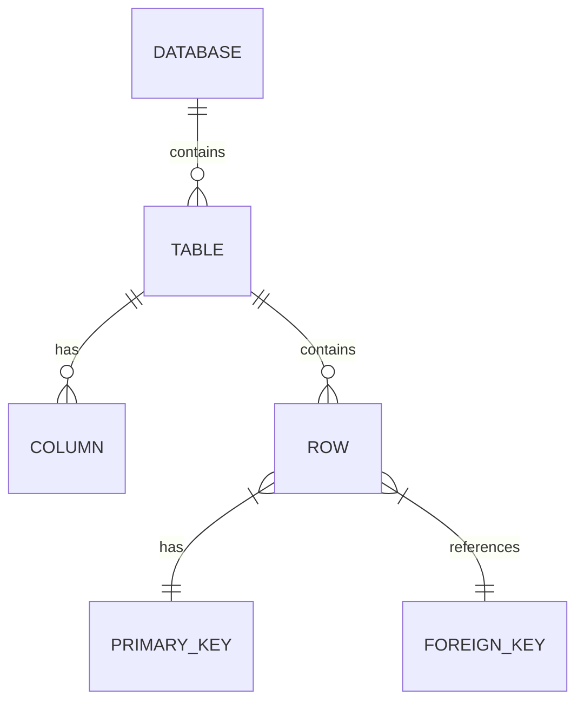

**核心术语：**

| 术语 | 说明 |
|------|------|
| **Database (数据库)** | 数据存储的容器，一个项目通常有多个数据库 |
| **Table (表)** | 由行和列组成的二维数据结构，类似 Excel |
| **Row (行/记录)** | 表中的一条数据 |
| **Column (列/字段)** | 表中的属性，如 id、name、age |
| **Primary Key (主键)** | 唯一标识每行数据的字段，不能重复，不能为空 |
| **Foreign Key (外键)** | 用于关联其他表的字段 |
| **Index (索引)** | 加速数据查询的数据结构，类似书的目录 |

### 1.3 SQL 是什么

**SQL (Structured Query Language)** 是用于操作关系型数据库的标准语言。

```sql
-- 查询数据
SELECT * FROM users WHERE age > 18;

-- 插入数据
INSERT INTO users (name, email) VALUES ('张三', 'zhangsan@example.com');

-- 更新数据
UPDATE users SET status = 1 WHERE id = 1;

-- 删除数据
DELETE FROM users WHERE id = 1;
```

**SQL 分类：**

| 分类 | 命令 | 说明 |
|------|------|------|
| **DDL** (数据定义) | CREATE, DROP, ALTER | 创建/删除/修改表结构 |
| **DML** (数据操作) | INSERT, UPDATE, DELETE | 增删改数据 |
| **DQL** (数据查询) | SELECT | 查询数据 |
| **DCL** (数据控制) | GRANT, REVOKE | 权限管理 |

---

## 二、事务与一致性

### 2.1 什么是事务

**事务 (Transaction)** 是数据库执行的基本单元，它把一组操作打包成一个"要么全成功，要么全失败"的整体。

**事务的四大特性 (ACID)：**

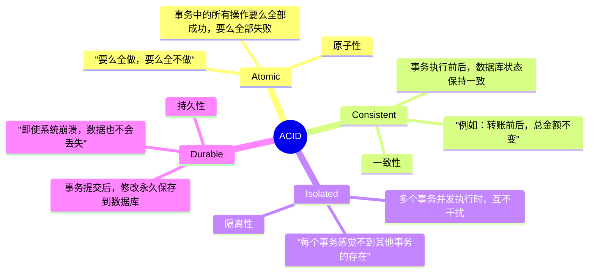

**事务的典型使用场景：**

```sql
-- 转账场景：从小明账户转100元到小红账户
START TRANSACTION;  -- 开始事务

UPDATE accounts SET balance = balance - 100 WHERE user_id = 1;  -- 小明减100
UPDATE accounts SET balance = balance + 100 WHERE user_id = 2;  -- 小红加100

COMMIT;  -- 提交事务，两条操作都生效

-- 如果中间出错，可以回滚：
-- ROLLBACK;  -- 撤销所有操作
```

### 2.2 CAP 定理

CAP 定理是分布式系统的基本原则：

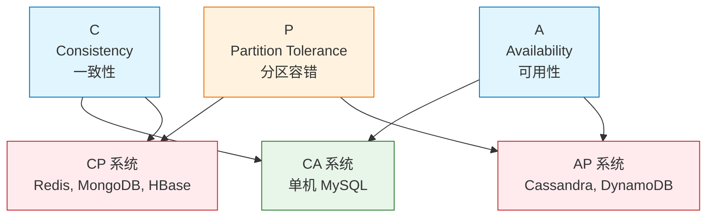

| 特性 | 说明 | 典型场景 |
|------|------|----------|
| **Consistency (一致性)** | 所有节点在同一时刻看到相同的数据 | 银行转账 |
| **Availability (可用性)** | 每个请求都能得到响应（不管是否最新） | 电商商品列表 |
| **Partition Tolerance (分区容错)** | 系统在网络分区时仍能运行 | 分布式系统必须满足 |

> **注意**：分布式系统必须满足 P，所以实际上是在 C 和 A 之间权衡。

### 2.3 BASE 理论

BASE 是对 CAP 中一致性的权衡方案：

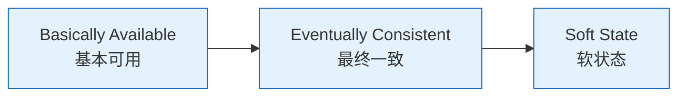

| 特性 | 说明 |
|------|------|
| **Basically Available (基本可用)** | 允许系统在故障时损失部分可用性 |
| **Soft state (软状态)** | 允许数据在不同节点间存在中间状态 |
| **Eventually consistent (最终一致)** | 系统在一段时间后达到一致状态 |

**典型应用**：Redis 缓存、分布式事务、充血模型

---

## 三、索引与性能

### 3.1 索引的概念

**索引** 是数据库中加速数据查找的数据结构，类似书的目录。

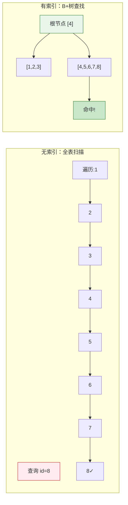

### 3.2 索引的类型

| 索引类型 | 说明 | 示例 |
|----------|------|------|
| **主键索引** | 主键自动创建，唯一且非空 | `PRIMARY KEY id` |
| **唯一索引** | 字段值唯一，允许空值 | `UNIQUE email` |
| **普通索引** | 普通加速查询 | `INDEX idx_name` |
| **全文索引** | 全文搜索引擎 | `FULLTEXT content` |
| **组合索引** | 多字段组合索引 | `INDEX idx_a_b (a, b)` |

**组合索引的最左前缀原则：**

```sql
-- 创建组合索引
CREATE INDEX idx_user_age_status ON users(age, status);

-- 以下查询能使用索引
SELECT * FROM users WHERE age = 25;           ✓ 使用
SELECT * FROM users WHERE age = 25 AND status = 1;  ✓ 使用

-- 以下查询不能使用索引
SELECT * FROM users WHERE status = 1;         ✗ 不使用
SELECT * FROM users WHERE age > 25;           ✗ 不使用 (范围查询)
```

### 3.3 索引的优缺点

| 优点 | 缺点 |
|------|------|
| 加速查询 (通常 10-100 倍) | 占用磁盘空间 |
| 减少 I/O 操作 | 写入时需要维护索引，增加开销 |
| 支持唯一性约束 | 过多索引会增加维护成本 |

**哪些字段适合建索引：**
- WHERE 条件中经常使用的字段
- JOIN 关联的字段
- ORDER BY、GROUP BY 的字段
- 区分度高的字段 (如 id、email)

**哪些字段不适合建索引：**
- 区分度低的字段 (如性别、状态)
- 频繁更新的字段
- 数据量小的表

### 3.4 慢查询优化

**定位慢查询：**

```sql
-- 查看慢查询日志配置
SHOW VARIABLES LIKE 'slow_query%';
SHOW VARIABLES LIKE 'long_query_time';

-- 开启慢查询日志
SET GLOBAL slow_query_log = 'ON';
SET GLOBAL long_query_time = 1;  -- 超过1秒记录

-- 查看慢查询日志
SHOW FULL PROCESSLIST;  -- 查看正在执行的查询
```

**EXPLAIN 分析查询：**

```sql
EXPLAIN SELECT * FROM users WHERE email = 'test@example.com';
```

**关键字段解读：**

| 字段 | 说明 | 理想值 |
|------|------|--------|
| `type` | 连接类型 | ref, eq_ref, const |
| `key` | 使用的索引 | 非 NULL |
| `rows` | 扫描行数 | 越小越好 |
| `Extra` | 额外信息 | Using index, Using filesort |

---

## 四、MySQL 存储引擎

### 4.1 常见存储引擎

| 引擎 | 特点 | 适用场景 |
|------|------|----------|
| **InnoDB** | 支持事务、行级锁、外键 (默认) | 绝大多数场景 |
| **MyISAM** | 不支持事务、只支持表级锁 | 只读/日志表 |
| **Memory** | 数据存内存，重启丢失 | 临时表、缓存 |
| **Archive** | 压缩存储，适合归档 | 归档数据 |

### 4.2 InnoDB vs MyISAM

| 特性 | InnoDB | MyISAM |
|------|--------|--------|
| **事务** | ✓ 支持 | ✗ 不支持 |
| **锁** | 行级锁 | 表级锁 |
| **外键** | ✓ 支持 | ✗ 不支持 |
| **崩溃恢复** | ✓ 自动恢复 | ✗ 需手动修复 |
| **全文索引** | 5.6+ 支持 | ✓ 原生支持 |
| **适用场景** | 业务数据 | 只读表、日志 |

**选择建议**：除非有特殊理由，否则一律使用 **InnoDB**。

### 4.3 事务隔离级别

事务隔离级别定义了并发事务之间的可见性：

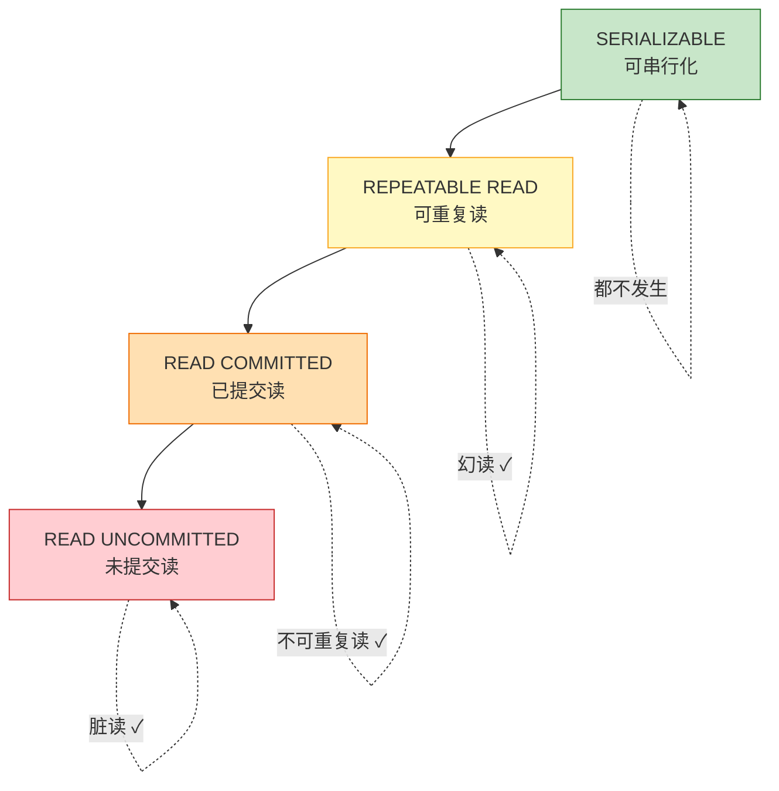

| 隔离级别 | 脏读 | 不可重复读 | 幻读 | 说明 |
|----------|------|------------|------|------|
| **READ UNCOMMITTED** | ✓ 可能 | ✓ 可能 | ✓ 可能 | 最低隔离，读取未提交数据 |
| **READ COMMITTED** | ✗ 不可能 | ✓ 可能 | ✓ 可能 | 读取已提交数据 (Oracle 默认) |
| **REPEATABLE READ** | ✗ 不可能 | ✗ 不可能 | ✓ 可能 | 同一事务内多次读取一致 (MySQL 默认) |
| **SERIALIZABLE** | ✗ 不可能 | ✗ 不可能 | ✗ 不可能 | 最高隔离，强制串行 |

```sql
-- 查看当前隔离级别
SELECT @@transaction_isolation;

-- 设置隔离级别
SET TRANSACTION ISOLATION LEVEL READ COMMITTED;
```

### 4.4 锁机制

**锁的类型：**

| 锁类型 | 说明 | 示例 |
|--------|------|------|
| **共享锁 (S)** | 读取数据时加锁，其他事务可读不可写 | `SELECT ... LOCK IN SHARE MODE` |
| **排他锁 (X)** | 写入数据时加锁，其他事务不可读不可写 | `SELECT ... FOR UPDATE` |
| **表级锁** | 锁定整张表，开销小，并发低 | MyISAM 默认 |
| **行级锁** | 锁定单行，开销大，并发高 | InnoDB 默认 |

**死锁：**

```sql
-- 死锁示例
-- 事务A: UPDATE users SET name='A' WHERE id=1;  -- 锁住 id=1
-- 事务B: UPDATE orders SET status=1 WHERE id=1; -- 锁住 id=1
-- 事务A: UPDATE orders SET status=1 WHERE id=1; -- 等待事务B释放 id=1 的锁
-- 事务B: UPDATE users SET name='B' WHERE id=1; -- 等待事务A释放 id=1 的锁
-- 死锁！双方互相等待对方释放锁
```

InnoDB 会自动检测死锁并回滚其中一个事务。

---

## 五、数据库设计

### 5.1 规范化设计

**数据库规范化** 是将数据拆分到多个表中，减少冗余的过程。

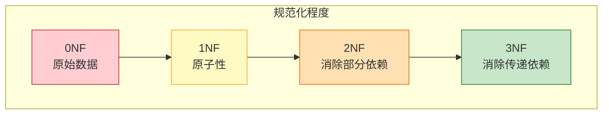

| 范式 | 要求 | 示例 |
|------|------|------|
| **1NF** | 字段原子性，不可再分 | ✗ 地址: "北京朝阳" → ✓ 城市: "北京", 区县: "朝阳" |
| **2NF** | 消除部分依赖 | 非主键字段必须完全依赖主键 |
| **3NF** | 消除传递依赖 | 非主键字段不依赖其他非主键字段 |

> **实战建议**：一般到 3NF 即可，不要过度规范化。

### 5.2 ER 图基础

**ER (Entity-Relationship) 图** 是描述实体及其关系的工具。

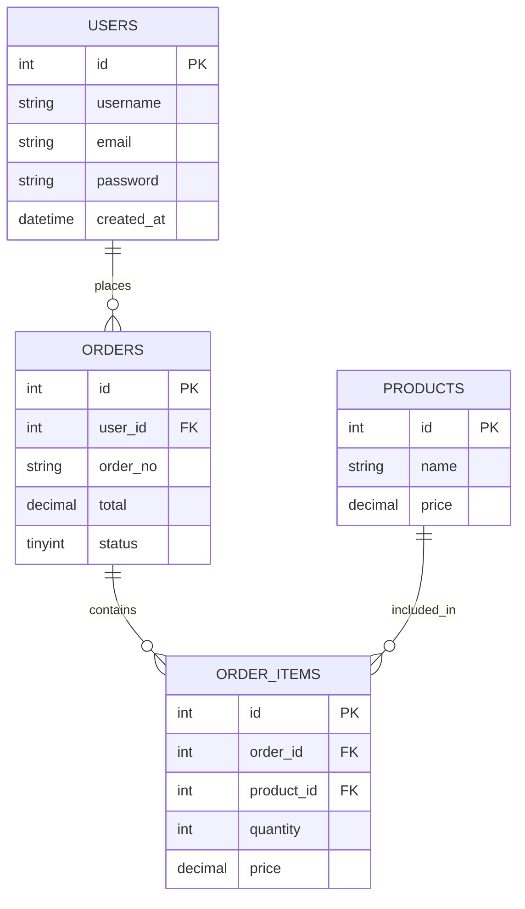

**关系类型：**

| 关系 | 符号 | 说明 |
|------|------|------|
| **1:1 (一对一)** | `||--||` | 用户和用户详情表 |
| **1:n (一对多)** | `||--o{` | 用户和订单表 |
| **n:m (多对多)** | `}o--o{` | 学生和课程表 (需要中间表) |

### 5.3 常见设计模式

**1. 软删除 (Soft Delete)：**

```sql
-- 不真正删除数据，而是标记删除状态
ALTER TABLE users ADD COLUMN deleted_at DATETIME DEFAULT NULL;

SELECT * FROM users WHERE deleted_at IS NULL;  -- 查询未删除的
UPDATE users SET deleted_at = NOW() WHERE id = 1;  -- 软删除
```

**2. 创建时间与更新时间：**

```sql
CREATE TABLE users (
    id BIGINT PRIMARY KEY AUTO_INCREMENT,
    name VARCHAR(50),
    created_at DATETIME DEFAULT CURRENT_TIMESTAMP,
    updated_at DATETIME DEFAULT CURRENT_TIMESTAMP ON UPDATE CURRENT_TIMESTAMP
);
```

**3. 逻辑删除 vs 物理删除：**

| 方式 | 优点 | 缺点 |
|------|------|------|
| **逻辑删除** | 数据可恢复，保留历史 | 查询需加条件，索引冗余 |
| **物理删除** | 彻底清除，节省空间 | 数据不可恢复 |

**4. 分库分表：**

当单表数据量超过千万级时，考虑分表：

| 方式 | 说明 |
|------|------|
| **垂直分表** | 按字段拆分成多张表 (冷热分离) |
| **水平分表** | 按行拆分到多张表 (按 id 或时间) |

---

## 六、MySQL 集群与高可用

### 6.1 主从复制

**原理**：主库 (Master) 负责写操作，从库 (Slave) 同步主库数据，承担读操作。

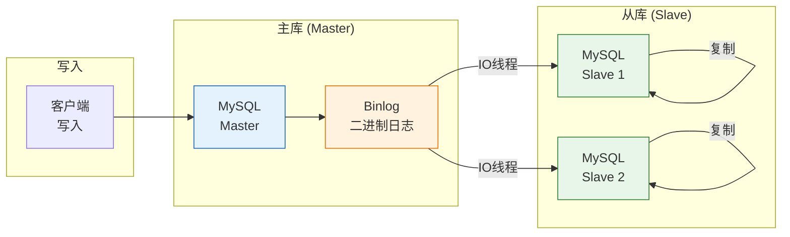

**复制方式：**

| 方式 | 说明 | 优点 | 缺点 |
|------|------|------|------|
| **异步复制** | 主库写入后立即返回，不等从库 | 性能高 | 可能丢数据 |
| **半同步复制** | 等待至少一个从库确认 | 数据安全 | 有延迟 |
| **全同步复制** | 等待所有从库确认 | 最安全 | 性能低 |

### 6.2 读写分离

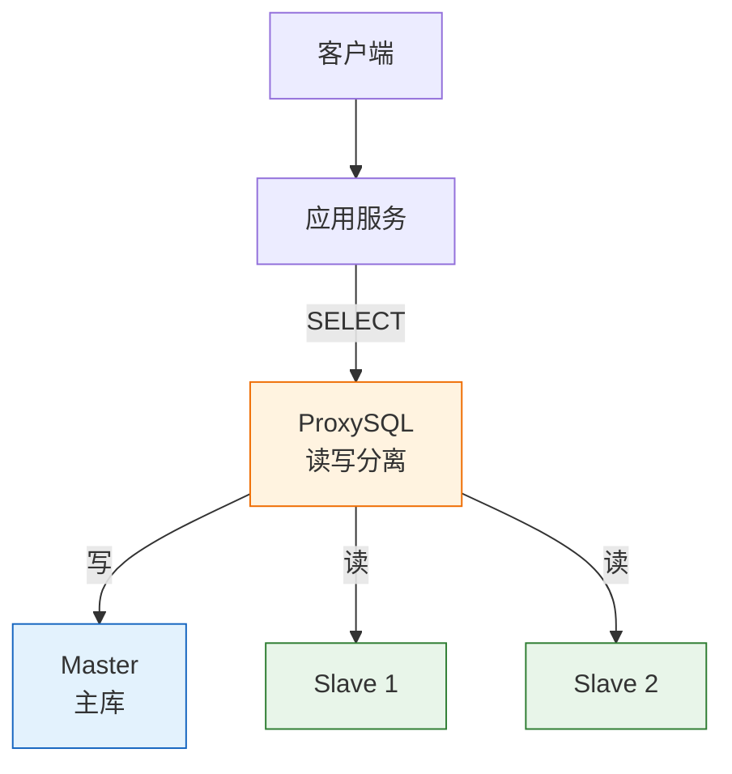

### 6.3 常见高可用方案

| 方案 | 说明 | 特点 |
|------|------|------|
| **主从 + Keepalived** | 双主 + VIP 漂移 | 简单易用 |
| **MHA (MySQL HA)** | 自动故障切换 | 自动选主 |
| **Orchestrator** | 拓扑管理与故障恢复 | 可视化管理 |
| **ProxySQL / MySQL Router** | 中间件读写分离 | 透明切换 |
| **MySQL Group Replication (MGR)** | MySQL 官方集群方案 | 多主写入 |

---

## 七、Redis 入门

### 7.1 Redis 是什么

**Redis** 是一个开源的内存数据库，支持多种数据结构，常用于缓存和消息队列。

| 特性 | 说明 |
|------|------|
| **内存存储** | 数据存内存，读取速度极快 (10万+/秒) |
| **数据结构丰富** | String、Hash、List、Set、ZSet |
| **持久化** | 支持 RDB 和 AOF 两种持久化方式 |
| **主从复制** | 支持一主多从架构 |
| **高可用** | 支持 Redis Sentinel 和 Cluster |

### 7.2 常见数据结构

| 数据结构 | 命令示例 | 适用场景 |
|----------|----------|----------|
| **String** | `SET key value` `GET key` | 缓存、计数器、Session |
| **Hash** | `HSET user name Tom` `HGET user name` | 存储对象 |
| **List** | `LPUSH list a` `LRANGE list 0 -1` | 消息队列、最新列表 |
| **Set** | `SADD tags 1` `SMEMBERS tags` | 标签、好友关系 |
| **ZSet** | `ZADD leaderboard 100 user1` `ZRANGE leaderboard 0 10` | 排行榜、分数排序 |

### 7.3 Redis vs MySQL

| 特性 | MySQL | Redis |
|------|-------|-------|
| **存储位置** | 磁盘 | 内存 |
| **数据模型** | 关系型表 | 多种数据结构 |
| **查询方式** | SQL | Key-Value / API |
| **持久化** | 默认开启 | 可选 (RDB/AOF) |
| **适用场景** | 业务数据持久化 | 缓存、Session、实时数据 |

**经典组合：MySQL + Redis**

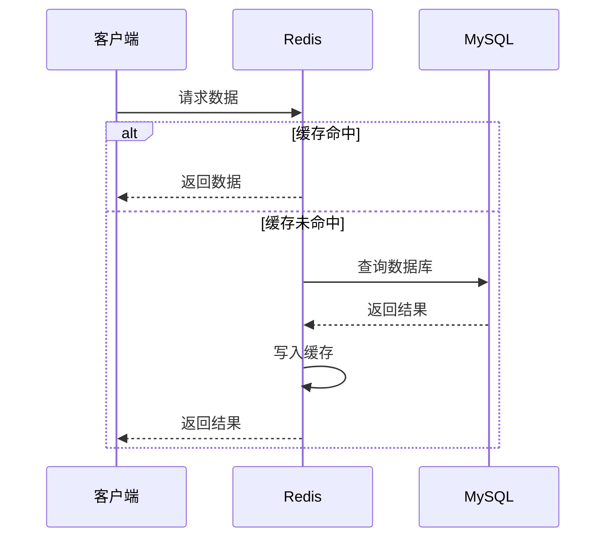

---

## 八、学习路径建议


---

## 九、常用命令速查

### MySQL 常用命令

```bash
# 连接数据库
mysql -u root -p

# 查看数据库
SHOW DATABASES;

# 使用数据库
USE db_name;

# 查看表
SHOW TABLES;

# 查看表结构
DESC table_name;
SHOW CREATE TABLE table_name;
```

### Redis 常用命令

```bash
# 连接 Redis
redis-cli

# 常用操作
SET key value
GET key
DEL key
KEYS pattern
FLUSHDB  # 清空当前数据库
```

---

> **参考资源**：
> - 《高性能 MySQL》
> - MySQL 官方文档: https://dev.mysql.com/doc/
> - Redis 官方文档: https://redis.io/documentation