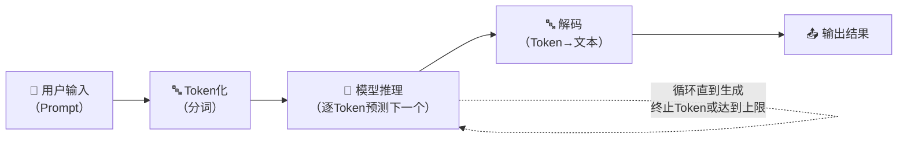
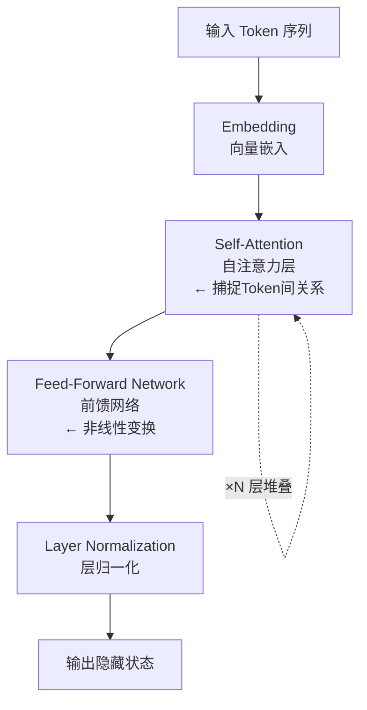
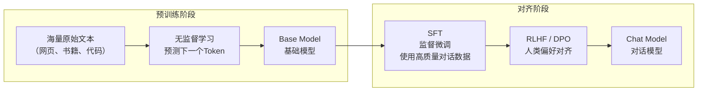
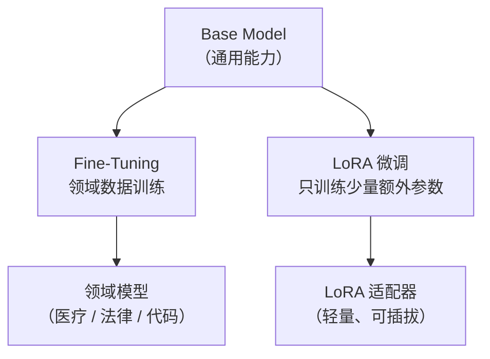
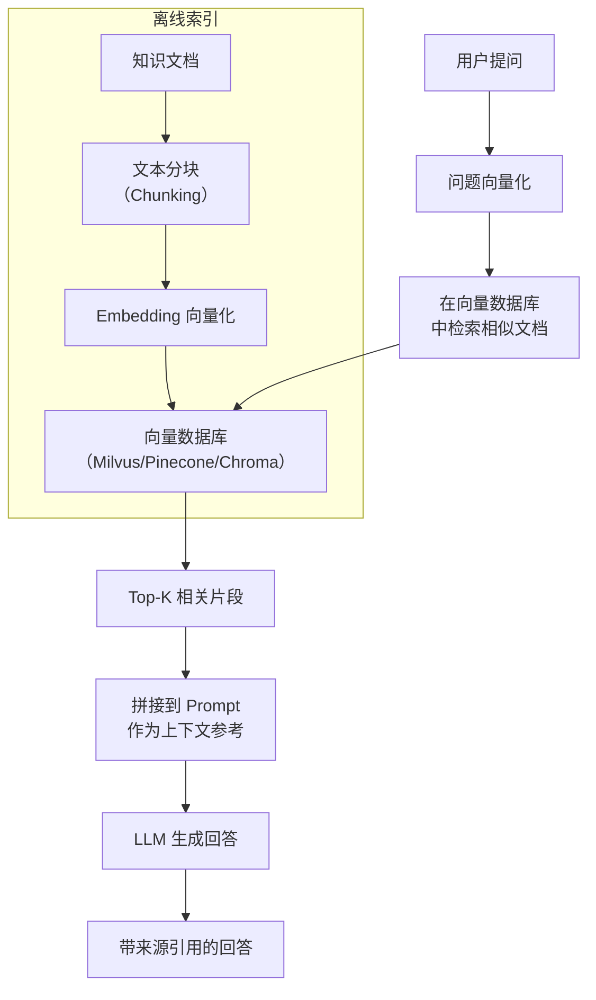
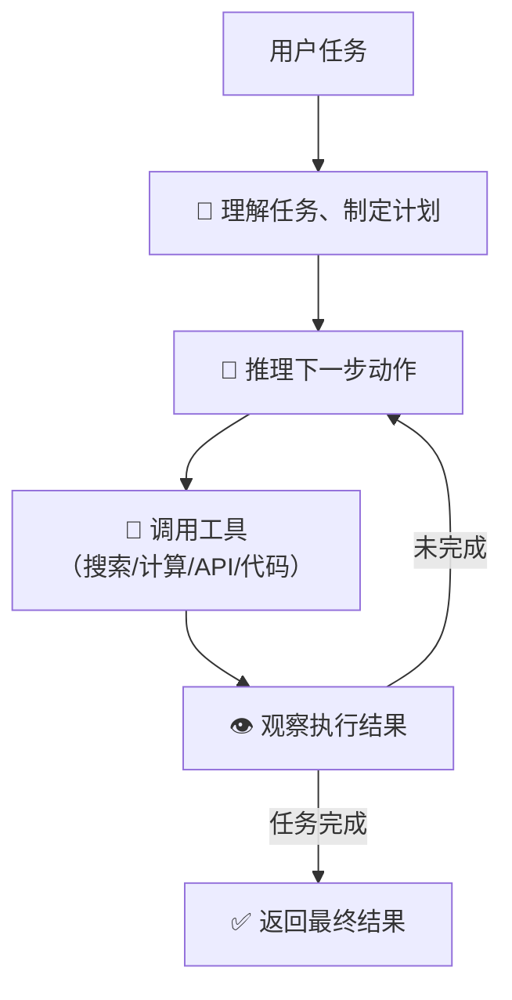
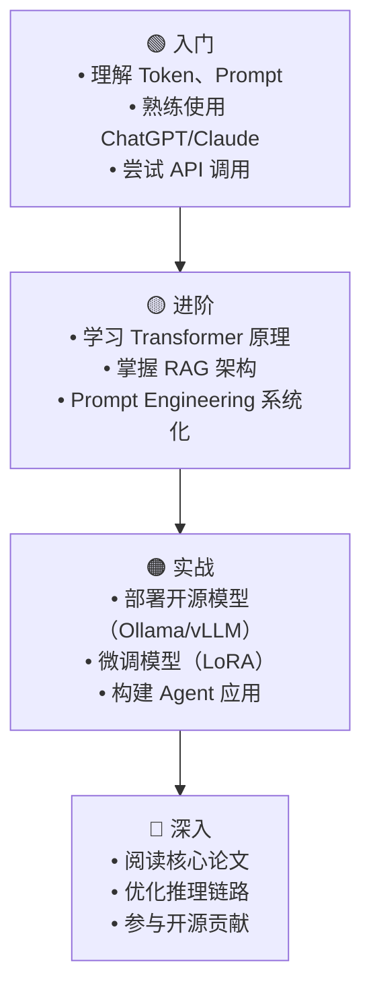

---
tags:
  - llm
  - 大模型
  - 概念解释
  - 学习笔记
created: 2026-05-14
updated: 2026-05-14
author: kuma
---

# 大模型（LLM）核心概念与名词解释

> 本文档面向初次接触大模型的开发者，系统性地介绍核心概念、关键术语和基础原理。

---

## 一、什么是大模型（LLM）

**大语言模型（Large Language Model, LLM）** 是一种基于深度学习的大规模神经网络，通过在海量文本数据上进行训练，学习语言的统计规律，从而具备理解、生成和处理自然语言的能力。

### 1.1 核心工作流程



### 1.2 "大"字的含义

- **参数规模大**：动辄数十亿到数千亿参数（GPT-5.5 约数万亿，DeepSeek-V4 约 685B）
- **训练数据大**：训练语料通常达数 TB 到数十 TB 级别
- **计算资源大**：训练需要数千张 GPU 持续运行数月

---

## 二、基础名词解释

### 2.1 Token（词元）

> Token 是模型处理文本的最小单位。一个 Token 约等于 0.75 个英文单词或 0.5 个中文字。

```
"Hello, world!" → ["Hello", ",", " world", "!"]
"你好世界"      → ["你好", "世界"]
"人工智能"      → ["人工", "智能"]
```

**关键指标：**
- **上下文窗口（Context Window）**：模型一次能处理的最大 Token 数量（如 GPT-5.5 128K、Claude Opus 4.7 500K）
- **Token 消耗**：API 计费的基本单位，输入和输出的 Token 都计费

### 2.2 Parameter（参数）

> 参数是神经网络中可学习的权重值，粗略反映了模型的"记忆容量"和复杂程度。

| 参数规模 | 代表模型 | 典型能力 |
|----------|----------|----------|
| 1B-7B | Qwen3-8B、Llama 4 Scout-7B | 轻量推理、端侧部署 |
| 7B-70B | Qwen3-32B、DeepSeek-V4 | 强推理、代码生成 |
| 70B-405B | Qwen3-72B、Llama 4 Behemoth-405B | 接近顶级闭源水平 |
| 1T+ | GPT-5.5、Claude Opus 4.7 | 顶级综合能力 |

### 2.3 Transformer

> Transformer 是几乎所有现代大模型的底层架构（2017 年 Google 提出）。核心创新是 **Self-Attention（自注意力）** 机制。



**关键概念：**
- **Self-Attention**：让每个 Token 都能"看到"序列中所有其他 Token，理解上下文关联
- **Multi-Head Attention**：多组注意力并行计算，捕捉不同维度的语义关系
- **Positional Encoding**：位置编码，让模型知道 Token 的顺序

### 2.4 Embedding（嵌入）

> 将文字、图片等离散数据转换为连续向量（一串数字），使计算机能够进行数学运算。

```
"猫"  → [0.23, -0.45, 0.78, ..., 0.12]  （通常 768-4096 维）
"狗"  → [0.21, -0.43, 0.80, ..., 0.15]  ← 与"猫"的向量距离很近
"汽车"→ [-0.67, 0.32, -0.11, ..., 0.55] ← 与"猫"距离较远
```

**用途：**
- 语义搜索（向量检索）
- RAG 的知识库索引
- 文本分类、聚类

---

## 三、模型训练与优化

### 3.1 训练阶段



**名词解释：**

| 缩写 | 全称 | 说明 |
|------|------|------|
| **Pre-training** | 预训练 | 在海量无标注数据上学习语言的统计规律 |
| **SFT** | Supervised Fine-Tuning | 使用人工标注的高质量 QA 数据训练对话能力 |
| **RLHF** | Reinforcement Learning from Human Feedback | 人类反馈强化学习——让人评价模型回答的好坏，用评价信号优化模型 |
| **DPO** | Direct Preference Optimization | RLHF 的简化替代方案，直接从偏好数据中学习，无需显式训练奖励模型 |

### 3.2 Fine-tuning（微调）

> 在预训练模型的基础上，使用特定领域的数据进行二次训练，使模型适应特定任务。



**常用微调方法：**

| 方法                   | 全称                  | 特点                      |
| -------------------- | ------------------- | ----------------------- |
| **Full Fine-Tuning** | 全量微调                | 更新所有参数，效果好但成本高          |
| **LoRA**             | Low-Rank Adaptation | 只训练小的低秩矩阵，参数效率高，是当前主流   |
| **QLoRA**            | Quantized LoRA      | LoRA + 量化，可在消费级 GPU 上微调 |
| **Adapter**          | 适配器                 | 在模型层间插入小型可训练模块          |
| **Prompt Tuning**    | 提示调优                | 不调模型参数，只优化软 Prompt 向量   |

---

## 四、推理与生成

### 4.1 Prompt（提示词）

> 用户输入给模型的文本指令，引导模型按预期方式生成回答。

**关键概念：**

```
┌─────────────────────────────────────────────┐
│  System Prompt（系统提示词）                  │
│  "你是一个专业的 Python 开发者..."             │
│  → 设定角色、行为边界和安全约束               │
├─────────────────────────────────────────────┤
│  User Prompt（用户提示词）                    │
│  "请帮我写一个排序函数"                       │
│  → 具体任务请求                               │
├─────────────────────────────────────────────┤
│  Assistant Response（模型回复）               │
│  "好的，以下是一个快速排序的实现..."           │
├─────────────────────────────────────────────┤
│  （多轮对话时以上组合循环拼接）                │
└─────────────────────────────────────────────┘
```

**常见 Prompt 技巧：**

| 技巧 | 说明 | 示例 |
|------|------|------|
| **Zero-Shot** | 不给示例，直接提问 | "翻译成英文：你好" |
| **Few-Shot** | 给几个示例再提问 | "Q: 苹果→apple，Q: 香蕉→banana，Q: 西瓜→" |
| **Chain-of-Thought (CoT)** | 引导模型逐步推理 | "请一步步思考，首先...然后..." |
| **System Prompt** | 设定角色和规则 | "你是一个严谨的数学老师" |

### 4.2 Temperature（温度）

> 控制输出的随机性程度。范围通常 0-2。

- **低温度（0-0.3）**：输出更确定、一致，适合代码生成、翻译、事实问答
- **高温度（0.7-1.5）**：输出更多样、有创意，适合写作、头脑风暴

```
Temperature = 0.1: "你好" → 总是选概率最高的Token，输出几乎固定
Temperature = 1.0: "你好" → 有较大随机性，每次可能不同
```

### 4.3 Top-P / Top-K（核采样）

> 控制每一步生成时考虑的候选词范围，影响输出的多样性与质量。

- **Top-K**：只从概率最高的 K 个 Token 中采样
- **Top-P（Nucleus Sampling）**：只从累积概率达到 P 的最小 Token 集合中采样

```
候选词概率：A:40%  B:30%  C:15%  D:10%  E:5%

Top-K=3 → 在 {A, B, C} 中随机选
Top-P=0.8 → 在 {A, B, C} 中随机选（累积=85% ≥ 80%）
```

### 4.4 Hallucination（幻觉）

> 模型生成了看似合理但实际错误或虚构的内容。这是大模型的固有缺陷。

**缓解方法：**
- **RAG（检索增强生成）**：先检索真实知识再生成
- **Grounding**：将生成内容锚定在给定文档中
- **降低 Temperature**：减少随机性
- **明确指示**："如果你不确定，请说你不知道"

---

## 五、高级技术概念

### 5.1 RAG（Retrieval-Augmented Generation，检索增强生成）

> 在生成回答前，先从知识库中检索相关信息，将检索结果作为上下文提供给模型，从而提高回答的准确性和时效性。



**关键环节：**
- **Chunking（分块策略）**：如何切分文档（按句子、段落、语义边界）
- **Embedding 模型**：文本向量化的质量直接影响检索精度
- **Rerank（重排序）**：对初检结果做精排，提升相关性
- **Hybrid Search**：结合关键词（BM25）和语义（向量）的混合检索

### 5.2 Agent（智能体）

> 让大模型不仅能"说话"，还能"行动"——通过调用工具、执行多步骤任务、与环境交互来完成复杂目标。



**Agent 的核心能力：**
- **Tool Use**：调用外部 API、数据库、代码执行器
- **Planning**：将复杂任务分解为子步骤
- **Memory**：短时记忆（上下文）+ 长时记忆（外部存储）
- **Reflection**：自我评估和纠错

### 5.3 Function Calling / Tool Use（工具调用）

> 模型不直接生成文本，而是输出一个结构化的函数调用请求，外部程序执行后将结果返回给模型。

```
用户："今天北京天气怎样？"

模型内部决策 → 需要调用 get_weather(city='北京')

模型输出（JSON）：
{
  "function": "get_weather",
  "parameters": { "city": "北京" }
}

外部系统执行 API 调用 → "北京今天晴，25°C"

模型基于结果生成回复 → "北京今天天气晴朗，气温25°C"
```

### 5.4 Multi-Modal（多模态）

> 模型不仅能处理文本，还能同时理解图像、音频、视频等多种输入方式。

| 模态 | 代表模型 | 能力 |
|------|----------|------|
| **文本** | GPT-5.5、Claude Opus 4.7、DeepSeek-V4 | 纯文本理解与生成 |
| **图文** | GPT-5.5、Claude Opus 4.7、Qwen3-VL | 看图回答问题、OCR |
| **文图生成** | DALL·E 3、Stable Diffusion、Midjourney | 文生图 |
| **语音** | GPT-5.5 (实时语音)、Whisper、CosyVoice | 语音识别/合成 |
| **视频** | Sora、Runway | 文生视频 |
| **全模态** | Gemini 3.5 Pro、GPT-5.5 | 综合处理文本+图像+音频+视频 |

### 5.5 Quantization（量化）

> 将模型参数从高精度（FP32/FP16）压缩到低精度（INT8/INT4），显著减少显存占用和推理延迟，代价是轻微的质量损失。

```
FP32（32位浮点）   → 1个参数占4字节  → 70B模型需要 ~280 GB 显存
INT8（8位整数）    → 1个参数占1字节  → 70B模型需要 ~70 GB 显存
INT4（4位整数）    → 1个参数占0.5字节 → 70B模型需要 ~35 GB 显存
```

**常用量化框架：** GGUF（llama.cpp）、GPTQ、AWQ、bitsandbytes

### 5.6 Attention 机制的变体

| 技术 | 说明 |
|------|------|
| **Multi-Head Attention (MHA)** | 原始 Transformer 的标准多头注意力 |
| **Multi-Query Attention (MQA)** | 所有 Head 共享同一组 KV，大幅减少 KV Cache |
| **Grouped-Query Attention (GQA)** | MHA 和 MQA 的折中——多个 Head 编组共享 KV |
| **Flash Attention** | 通过 GPU 显存层次优化的高效注意力实现 |
| **Sliding Window Attention** | 每个 Token 只关注固定窗口内的邻居，适合超长文本 |

### 5.7 MoE（Mixture of Experts，混合专家）

> 模型包含多个"专家"子网络，每次只激活其中一小部分，实现"参数多但计算少"的效果。

```
传统架构：每个Token经过全部参数（100%激活）
MoE架构：每个Token经过路由器 → 选择Top-2专家 → 仅激活部分参数

示例：DeepSeek-V4 总参数 685B，每次推理仅激活 37B
结果：参数规模大 → 知识丰富，计算量小 → 推理快
```

---

## 六、部署与服务

### 6.1 常见部署方式

| 方式 | 说明 | 适用场景 |
|------|------|----------|
| **API 调用** | 通过云服务商 API 调用 | 快速集成、无硬件要求 |
| **vLLM / TGI** | 高性能推理引擎，支持 PagedAttention | 自建服务，高并发 |
| **Ollama** | 桌面端一键运行本地模型 | 个人开发/测试 |
| **llama.cpp** | C++ 推理引擎，GGUF 量化模型 | 消费级硬件、端侧部署 |
| **Triton Inference Server** | NVIDIA 推理服务框架 | 企业级生产环境 |

### 6.2 推理优化技术

| 技术 | 说明 |
|------|------|
| **KV Cache** | 缓存已计算的 Key-Value，避免重复计算 |
| **Speculative Decoding** | 用小模型快速"草稿"生成，大模型并行验证 |
| **Continuous Batching** | 动态合并请求提高 GPU 利用率 |
| **PagedAttention** | 将 KV Cache 按页管理，减少显存碎片 |
| **Prefix Caching** | 相同 Prompt 前缀的 KV Cache 可复用 |

---

## 七、主流模型一览

> 截至 2026 年 5 月，全球主要活跃大模型及关键信息。

### 7.1 海外闭源模型

| 模型 | 厂商 | 发布时间 | 上下文窗口 | 关键特点 |
|------|------|----------|------------|----------|
| **GPT-5.5** | OpenAI | 2026.04 | 128K | 最新旗舰，深度推理能力极强，多模态（文本+图像+语音+视频），工具调用能力业界领先 |
| **Claude Opus 4.7** | Anthropic | 2026.04 | 500K | 超长上下文标杆，代码/复杂推理顶级，强调安全对齐，支持 Computer Use |
| **Gemini 3.5 Pro** | Google | 2026.04 | 1M | 多模态深度融合（原生文本+图像+音频+视频+代码），Google 生态整合，TPU 推理 |
| **Grok-4** | xAI | 2026.04 | 1M | Elon Musk 旗下，实时 X 平台数据接入，幽默/反叛风格，超长上下文 |

### 7.2 国内模型

| 模型 | 厂商 | 发布时间 | 上下文窗口 | 关键特点 |
|------|------|----------|------------|----------|
| **DeepSeek-V4** | DeepSeek | 2026.04 | 128K | MoE 架构（685B/37B），推理成本极低，代码/数学能力全球一线，MIT 开源 |
| **DeepSeek-R1** | DeepSeek | 2025.12 | 128K | 专用推理模型，CoT 深度思考，思维链可读化，复杂推理表现优异 |
| **Qwen3（通义千问）** | 阿里 | 2026.03 | 128K | 0.5B-72B 全系列覆盖，中文理解最强之一，MoE 版性价比高，Apache 2.0 开源 |
| **GLM-5** | 智谱 AI | 2026.04 | 128K | 国产闭源标杆，Agent 能力突出，AutoGLM 可实现复杂自主任务 |
| **Kimi-K2** | Moonshot（月之暗面） | 2026.03 | 1M | 超长上下文处理专家，文档分析/长文写作出色，1M 窗口实际可用 |
| **MiniMax-M1** | MiniMax | 2025.12 | 4M | 4M 超长上下文（全球最大），线性注意力突破，处理超长文档/视频 |
| **Doubao-1.6（豆包）** | 字节跳动 | 2026.03 | 256K | 多模态（文本+图+视频），与抖音/TikTok 生态整合，性价比极高 |
| **Step-3（阶跃星辰）** | 阶跃星辰 | 2026.02 | 256K | 多模态能力突出，文本+图像+视频生成一体化 |
| **Hunyuan-T2（混元）** | 腾讯 | 2026.01 | 128K | 与微信/腾讯会议等产品集成，企业级应用场景丰富 |

### 7.3 推理专用模型对比

> 推理模型善于"慢思考"，在数学、编程、逻辑推理等领域表现远超通用模型。

| 模型 | 厂商 | 核心机制 | 代表场景 |
|------|------|----------|----------|
| **OpenAI o4-pro / o4** | OpenAI | 深度强化学习 + 超长内部推理链 | 数学竞赛、博士级科学推理 |
| **DeepSeek-R1** | DeepSeek | 强化学习 + 冷启动数据、MIT 开源 | 数学、编程、推理（性价比之王） |
| **Claude Opus 4.7 (Extended Thinking)** | Anthropic | 可配置的扩展思考模式，长链推理 | 复杂代码架构、法律/医学推理 |
| **Gemini 3.5 Pro (Deep Think)** | Google | 自适应推理深度，结合搜索增强 | 多模态推理、实时信息结合 |
| **Qwen3-235B-Thinking** | 阿里 | Qwen3 基座 + 强化学习推理增强 | 中英双语推理场景 |

### 7.4 模型选择快速指南

| 使用场景 | 推荐模型 | 理由 |
|----------|----------|------|
| 日常对话/写作 | GPT-5.5、Claude Opus 4.7、Qwen3-72B | 综合能力强，输出质量高 |
| 编程/代码 | Claude Opus 4.7、GPT-5.5、DeepSeek-V4 | 代码理解生成能力顶级 |
| 深度推理 | OpenAI o4-pro、DeepSeek-R1、Qwen3-Thinking | 慢思考、多步推理 |
| 长文档处理 | Kimi-K2、Gemini 3.5 Pro、Claude Opus 4.7 | 超长上下文窗口 |
| 多模态理解 | Gemini 3.5 Pro、GPT-5.5、Doubao-1.6 | 原生多模态 |
| 低成本/自部署 | DeepSeek-V4、Qwen3（开源）、Llama 4 | 开源、推理成本低 |
| 端侧/移动端 | Gemma 3-4B、Phi-4、Qwen3-4B | 模型小、速度快 |
| 中文场景 | Qwen3、DeepSeek-V4、GLM-5、Kimi-K2 | 中文能力经过深度优化 |
| 学术研究 | OLMo 2、DeepSeek-R1、Llama 4 | 完全开源，可复现 |

---

## 八、学习路径建议



---

> **参考资源：**
> - Andrej Karpathy - Intro to Large Language Models (YouTube)
> - Hugging Face NLP Course
> - 《大规模语言模型：从理论到实践》（复旦团队）
> - Papers: "Attention Is All You Need", "Scaling Laws for Neural Language Models"
