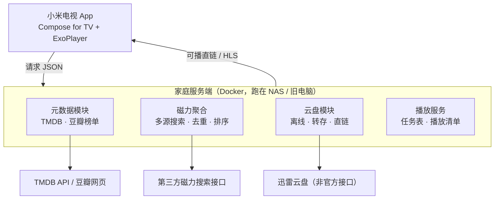

---
tags:
  - 技术文档
  - 方案调研
  - android-tv
  - douban
  - xunlei
  - alist
  - moviepilot
  - emby
  - strm
  - 家庭影院
  - xiaoya
  - tvbox
created: 2026-10-15
updated: 2026-10-15
author: kuma
---

# 小米电视影视聚合方案调研：豆瓣 → 磁力 → 迅雷云盘 → 播放

## 一、需求拆解

原始需求可以拆成 4 个独立环节，每个环节的成熟度差别很大：

| 环节 | 具体动作 | 技术难度 | 成熟度 |
|------|----------|----------|--------|
| ① 元数据 | 获取豆瓣电影/电视剧榜单、评分、简介、海报 | 中 | 无官方 API，需绕路 |
| ② 资源发现 | 调第三方磁力搜索接口，拿到 magnet 与做种信息 | 低 | 接口多但易失效 |
| ③ 资源落地 | magnet 转存/离线到迅雷云盘，取可播直链 | 高 | 非官方接口，需逆向 |
| ④ 播放 | 电视端大屏 UI + 遥控器操作 + 播放直链 | 中 | 生态成熟，可复用 |

**核心结论**：③ 是最难也最不稳定的一环，④ 是最好复用的一环。**不要从零写"磁力播放器"**，把 ③ 交给服务器/网盘，电视端只做"播放器 + 遥控器 UI"。

---

## 二、GitHub 现成项目盘点

### 路线 A：TVBox 生态（Android TV 客户端 + 可插拔爬虫）

| 项目 | 定位 | 对本需求的价值 |
|------|------|----------------|
| `lushunming/AndroidCatVodSpider` | Java 写 Spider，编译成 `custom_spider.jar` 给 TVBox 加载 | 可复用为"豆瓣榜单 + 磁力搜索"源的骨架 |
| `gaotianliuyun/gao`（drpy2 JS 引擎 + 源集合） | 用 JS 写源（`type:3`，`api` 指向 `drpy2.min.js`，`ext` 指向站点 JS） | **改造成本最低**，无需编译 Android 工程 |
| TVBox 系客户端：FongMi TV / takagen99 Box / TVBoxOSC | Android TV 播放壳 | 直接装在小米电视上，遥控器体验现成 |
| 现成源里的 `豆瓣[js]`、`磁力熊` | 榜单 + 磁力搜索源 | 已验证过可行性，能直接借鉴写法 |

**关键点**：TVBox 的配置源生态里，"豆瓣榜单源"和"磁力搜索源"都已经有人写过。你要做的是把它们串成一条链：榜单 → 详情 → 磁力候选列表 → 播放。播放环节依赖壳子内置或第三方的磁力解析接口（把 magnet 转成 HTTP 流），**这一环稳定性取决于外部服务，不可控**。

### 路线 B：NAS/Docker 一体化（服务端自动化 + 电视端只播）

| 项目 | 定位 | 对本需求的价值 |
|------|------|----------------|
| `jxxghp/MoviePilot` | 媒体库自动化：豆瓣+TMDB 元数据、订阅追更、按规则搜资源、自动下载、重命名、通知，300+ 插件 | **最贴合上半段需求**，豆瓣数据源和搜索订阅都是现成的 |
| `MoviePilot-Plugins-Third` 系列插件 | Nullbr 资源搜索（115 网盘/磁力/ed2k/m3u8），配 CloudDrive2 做磁力离线、115 分享转存 | 证明"搜磁力 → 网盘离线 → 转存"这条路有人跑通了 |
| `fish2018/pansou` | 网盘资源搜索聚合（TG 频道 + 异步插件 + 二级缓存），Docker 一键部署 | 直接当"资源发现层"用，省掉自己写聚合 |
| Alist / OpenList | 存储网关：挂载迅雷云盘、115、夸克、天翼、PikPak、百度等 | 挂载迅雷云盘的 `Thunder` 驱动已存在 → WebDAV 输出 |
| Kodi / Nova Video Player / VLC / 迅雷 TV 版 | 电视端播放器 | 播放端几乎不用自研 |

**关键点**：Alist 的迅雷驱动只做**文件管理/下载/播放**，**不提供磁力离线**；把 magnet 加进迅雷云盘还得靠逆向的离线接口（见下）。另外 Alist 挂迅雷需要"手机号 + 密码 + 从 `pan.xunlei.com` DevTools 里捞 `x-captcha-token`"这类非常规操作，接口随时会变。

### 路线 C：本地磁力边下边播（不经过网盘）

| 项目 | 说明 |
|------|------|
| `TorrServe` / `TorrServe-MatriX` | GPL3，专为 Android TV 优化。把电视变成 BT 流媒体服务器，magnet → 本地 HTTP 流 → MX/VLC 播放，支持边下边播、缓存调优 |

适合"不想买网盘会员"的场景，但电视盒子的存储/功耗/上传带宽承压，体验不如服务端离线。

### 路线 D：Web 聚合站 + TV 客户端（可参考的前端/客户端实现）

`MoonTV` / `LunaTV` / `LibreTV` / `Selene-TV` / `OrionTV` 这一系：Web 影视聚合站 + 手机端 + Android TV 客户端（Kotlin + Compose for TV + ExoPlayer，或用 Tauri 套壳跨平台）。

它们走的是 **m3u8 采集源**而不是磁力/网盘，业务链路不同，但**电视端界面、焦点管理、扫码登录、手机当遥控器**这些实现可以直接抄。

---

## 三、必须正视的三个现实约束

### 1. 豆瓣没有对外开放的 API

豆瓣 API 早在 2019 年前后就不再对外开放，现在只有四条路：

- **爬网页**：反爬严格（UA 校验、频率限制、滑块、IP 封禁），且属于抓取他人数据，合规上有争议。
- **第三方中转/镜像**：都是社区维护，随时失效，且多数本身就是爬虫代理。
- **换 TMDB**：官方免费 API，字段规范，中文简繁体数据可用，是**工程上最稳的选择**。
- **NeoDB**：开放 API，支持从豆瓣导入条目中文元数据，可作为"要豆瓣味"时的补充源。

> 建议：**以 TMDB 为元数据主源，豆瓣只做"评分 + 榜单"的增强层**，并且把元数据层设计成可替换的 Provider，别让爬虫成为地基。

### 2. 迅雷云盘没有官方开放接口，且能力本身要会员

- 社区做法是逆向 `pan.xunlei.com` 的 Web 接口（参考 `sang8052/thunder_pan_agent`：selenium 登录拿 `access_token`/`refresh_token`，再对外暴露 HTTP API 控制离线下载与云播）。
- 这类接口**没有兼容性承诺**，随时改版；账号还存在风控/限速风险。
- **关键反思**：网盘的离线下载、高速取回通常被划入会员特权。如果目标用户就是"不想买会员"，那这条链路的经济动机本身可能不成立——省下的是视频平台会员，换成了网盘会员。

### 3. 合规边界要说清楚

"磁力搜索 + 网盘转存 + 播放未授权影视"本质是盗版链路。国内对这类影视聚合应用和源作者已有实际执法先例。

- **自用**（自己编译、不公开分发、不维护公开源列表、不对外提供服务）：属于个人使用范畴，风险相对可控。
- **一旦公开分发 APK / 公开维护订阅源 / 对外提供接口**：性质立刻改变，风险陡增。

这是选择方案时必须先想清楚的一点。

### 4. 小米电视侧的现实问题

- PatchWall 基于 Android，允许侧载 APK（设置 → 账号与安全 → 允许安装未知来源应用，或用 U 盘 / 小米电视助手）。
- 部分机型对 `targetSdk` 和安装来源有额外限制，需实测。
- **遥控器交互是主要成本**：焦点管理、D-pad 导航、返回键、大字号、无触摸。用 Compose for TV / Leanback 会省很多事。

---

## 四、三条路线对比

| 维度 | A. TVBox + 自制源 | B. 服务端自动化（推荐） | C. 自研 App + 自研服务端 |
|------|-------------------|--------------------------|---------------------------|
| 编码量 | 极低（写 1 个 JS 源） | 极低（装 Docker + 配置） | 高（前后端 + 接口逆向） |
| 迭代速度 | 快 | 快 | 慢 |
| 磁力→播放 的稳定性 | 差（依赖第三方解析服务） | 好（服务端离线 + 直链） | 取决于自己维护的接口 |
| 电视端体验 | 好（壳子成熟） | 好（官方/成熟播放器） | 可定制，但要从零打磨 |
| 可控性 | 低 | 中 | 高 |
| 维护成本 | 源失效就修源 | 插件/接口失效 | 全部自己扛 |

**推荐顺序**：先用 **B** 快速验证需求是否真被满足；只有当你确认"必须自己掌控交互和链路"时，才走 **C**。

---

## 五、推荐架构（路线 C 的分层）

**分层原则**：外部接口只在服务端出现，电视端只认一个统一 JSON（`剧集/文件列表 + 播放地址 + 进度`）。这样任何外部接口失效，只改服务端，电视端 APK 不用重发。

---

## 六、自研实施步骤（路线 C 展开）

### 阶段 0：接口摸底（最该先做，决定后面所有工作量）

1. **元数据**：验证 TMDB 免费 Key 能否拿到中文标题/简介/海报/评分；再验证豆瓣榜单页/移动端接口能否稳定取到"评分 + 榜单"。
2. **磁力搜索**：挑 2–3 个接口，统一定义返回结构 `{title, size, seeders, magnet, source}`，写一个脚本验证可用率与延迟。
3. **迅雷云盘**：抓包确认这四个动作能否走通——登录态获取、添加离线任务（magnet）、轮询任务状态、获取文件播放地址。**这一步跑不通，整个方案就得改走 TorrServe 或换网盘。**

> 阶段 0 只写一次性脚本，不搭框架。跑不通就别往下走。

### 阶段 1：服务端

- 技术选型：FastAPI / NestJS + SQLite（缓存元数据、搜索历史、离线任务表）。
- 模块划分：
  - `metadata/`：TMDB 为主 + 豆瓣增强，统一输出内部元数据模型。
  - `magnet/`：多源并发搜索 → 归一化 → 去重（按 infoHash）→ 按做种数/体积/清晰度排序。
  - `xunlei/`：登录态管理（token 刷新）+ 添加离线 + 轮询 + 转存 + 取直链。
  - `play/`：对电视端输出统一播放清单。
- 关键设计：**电视端永远不接触 magnet 和网盘账号**，只拿服务端给的可播 URL。

### 阶段 2：电视端 App

- Kotlin + Jetpack Compose for TV（或 Leanback），Media3/ExoPlayer 播放。
- 或者 **成本更低的折中**：用 Tauri / WebView 套壳，前端直接复用现成 Web 页面（LibreTV 那类），只做遥控器适配。
- 页面流：首页榜单 → 详情 → 资源候选列表（显示体积/做种/来源）→ 加入云盘 / 立即播放 → 任务进度 → 播放页。
- 必须专门做的适配：D-pad 焦点、返回键、加载态、大字号、横屏、无鼠标。

### 阶段 3：部署与自用

- 服务端跑在家里 NAS / 旧电脑的 Docker 里，电视与服务器同局域网。
- 不开公网端口、不对外提供服务、不公开分发 APK 和配置源。

---

## 七、踩坑清单

| 坑 | 说明 |
|----|------|
| 豆瓣反爬 | 高频抓取会封 IP；榜单页结构改版即挂；不要把它当日更数据源 |
| 磁力接口失效 | 第三方接口寿命以周计，必须做多源 + 失败降级 + 本地缓存 |
| 迅雷 token 过期 | 需要定时刷新；`x-captcha-token` 这类参数得手工从浏览器捞 |
| 迅雷直链时效 | 直链通常带签名有效期，不能长期存储，必须"用时再取" |
| 网盘风控 | 短时间大量离线/转存可能触发限速或封禁 |
| 电视端播放 | 4K/HEVC/字幕需要硬件解码支持，ExoPlayer 要测目标机型 |
| 小米安装限制 | 部分机型需手动开"未知来源"，并可能因 targetSdk 被拦 |
| 接口逆向的法律属性 | 违反平台用户协议，且大陆地区已有相关执法先例 |

---

## 八、结论与建议

1. **不要从零造。** 想要的功能已经有 80% 现成：元数据 + 订阅 + 搜资源用 MoviePilot，资源发现用 PanSou，网盘挂载用 Alist/OpenList，电视端播放用迅雷 TV 版或 Kodi/VLC，本地磁力播放用 TorrServe。
2. **最省力的组合**：家里放一个小 Docker 服务（MoviePilot / PanSou / Alist），电视端只装播放器。零 APP 开发，链路可控。
3. **真要自研**：按"服务端定接口 → 电视端只做播放器和 UI"的分层做，并且**先跑通阶段 0 的接口摸底**再动工。元数据层别绑死豆瓣，绑 TMDB。
4. **动机复查**：网盘离线/加速本身多半也是会员能力，"省会员"未必省得下来；真正值得做的是**聚合搜索 + 自动化的省事**。
5. **合规**：自用、不公开分发、不对外提供服务；公开分发或维护公开源，风险等级完全不同。

---

## 九、需求修订：自用 + 父母使用 + 只接受网盘会员

> 2026-10-15 追加。使用者不是本人而是父母，唯一可接受的付费点是网盘会员。**这一节是最终结论，前面章节作为技术储备保留。**

### 9.1 需求重述

| 维度 | 修订后的约束 |
|------|--------------|
| 使用场景 | 自用，主要给父母在小米电视上看 |
| 付费意愿 | 不接受爱奇艺 / 腾讯 / 酷喵三份会员，**接受一份网盘会员** |
| 真实痛点 | 内容分散在三个 App、三份会员、三套搜索，父母找不到片 |
| 硬约束 | 父母不会搜索、不会选源、不会看做种数、不会处理异常 |

### 9.2 方向修正：不做"磁力搜索 App"，做"海报墙"

这是本节最重要的一句话：

> 父母的完整操作只有三步——**打开电视 → 看到海报 → 点开就播**。
> 任何需要"搜索关键词、比较资源、选择片源、处理失败重试"的设计，都不成立。

所以整条链路必须拆成两种角色：

- **维护者（你）**：找资源、配订阅、转存整理。这一环可以折腾、可以自动化。
- **使用者（父母）**：只看。这一环必须零操作。

原方案（自研 TV App + 磁力搜索 + 迅雷云盘）的问题在于：它把"选资源"这一步推到了电视端，而这一步恰恰是最不稳定、最需要判断力的一步。**修正后的做法是把"选资源"彻底留在服务端。**

### 9.3 网盘选型（唯一付费点）

| 网盘 | 资源丰富度 | TV 端播放 | 生态与直连 | 价格 | 结论 |
|------|-----------|-----------|-----------|------|------|
| **115** | 最高（原盘多） | TV 版无特色，会员才能在线看 | 最好：网易爆米花 / Vidhub 官方支持，STRM + 302 工具链最成熟 | 约 ¥158/年，常要多年起 | **做大库首选**，但风控严（全盘扫描易触发） |
| **夸克** | 上升中（阿里系迁移而来） | **TV 版自带海报墙**，新手最友好 | 一般，第三方挂载不如 115 | 约 ¥138/年，88VIP 可免费领 | **成本首选**，不风控；离线下载弱（主要靠转存分享链接） |
| **迅雷云盘** | 高（下载出身） | **TV 端在线播放体验最好**（倍速、在线字幕、音轨、跳片头尾） | 靠逆向挂载，直链时效短 | 视迅雷会员 | 适合"看什么临时离线什么"的轻量用法，**不适合做长期 STRM 库** |
| 阿里云盘 | 多 | 一般 | 三方权益包后第三方软件受限 | — | 资源党已迁出，**不建议新选** |

**选择建议**：
- 已经是 88VIP → **直接用夸克**，边际成本为零。
- 要做长期大库、要 302 直连和完整生态 → **115**。
- 已有迅雷会员 → 先拿迅雷试水，验证流程，再决定要不要换。

### 9.4 三档实施深度（渐进式，先让父母用起来）

#### 第 0 档：零开发、零服务端（当天可用）

- 小米电视应用商店直接安装：
  - **网易爆米花**——网盘聚合 + 海报墙，免费无广告，原生直连 115 / 百度 / 天翼等 8+ 网盘，也支持 WebDAV / SMB，**已上架小米 TV 商店**，无需侧载。
  - **夸克网盘 TV 版**——官方版自带海报墙，打开就能点着看，比爆米花还省一层。
  - 或 115 TV 版 / 迅雷云盘 TV 版。
- 你在手机/电脑上把父母想看的剧转存到网盘的固定目录（如 `/影视/给爸妈`）。
- 父母在电视上打开 App → 海报墙 → 点开。

> 这一档的目标不是"最终方案"，而是**一周内让父母用起来，并验证他们能不能独立操作**。如果这一步就不顺，后面所有自研都没有意义。

#### 第 1 档：加自动化（真正解决"追更"）

- 一台常开的设备：NAS / 旧笔记本 / 迷你主机，跑 Docker。
- **MoviePilot**：订阅父母想看的剧 → 自动搜索资源 → 自动转存 / 离线进网盘 → 自动重命名整理。
- 父母端**完全不用改**，网盘里"新集自动出现"。
- 这一档才是真正替代"三个平台会员"的关键：**剧集每周更新，不可能让你每周手动转存一次。**

#### 第 2 档：升级成私人影视库（可选）

- **STRM + Emby / Jellyfin / 飞牛影视**：真海报墙、观看进度记忆、多端同步、302 直连（播放时走网盘 CDN，不占服务端带宽）。
- 工具链组合：
  - MoviePilot 路线：`115strm助手` + `115网盘存储` + `Emby 302 反向代理` 三个插件。
  - 独立工具：`TgtoDrive` / `SmartStrm` / `p115strmhelper`（115 转存 + 生成 STRM，支持 302 直连）。
  - 原理：STRM 文件里不存直链（会过期），存 pickcode，由插件在播放时实时换直链。
- 电视端：Emby for Android TV / Jellyfin 客户端，或让爆米花走 SMB/WebDAV。
- **115 风控提醒**：媒体库不要做全盘扫描，先拿小库跑通流程。

#### 第 3 档：自研小米电视 App（只有第 2 档仍不满足时才做）

此时服务端已经就绪，**TV 端只做 UI**，不碰磁力、不碰迅雷接口，工作量比原始设想小一个数量级。

- 技术栈：Kotlin + Jetpack Compose for TV，直连 Emby / Jellyfin API 或网盘 API。
- 为父母定制的关键点：
  - 首页只留两个区：**继续观看** + **我挑的**。删掉搜索、分类、筛选、设置、登录。
  - 开机自启，返回键不退出，无任何弹窗和二次确认。
  - 大字号、大焦点、遥控器左右就能走完全流程。
  - 字幕/音轨自动选默认，不暴露选项。
- 兜底：如果连 Emby 客户端都够用，就**不要写这个 App**。

### 9.5 必须提前接受的两个短板

1. **独播内容拿不到。** 爱奇艺 / 腾讯 / 芒果的独播剧和综艺，网盘上经常没有高清源，或者要滞后几天。网盘方案**不能 100% 替代三个平台会员**，尤其是父母正在追的独播剧和热门综艺。建议保留一个平台的会员作为兜底（优先留父母看得最多的那个）。
2. **父母仍然需要教一次。** 即使是最简的海报墙，也要教"怎么进 App、怎么选剧、字幕怎么开"。降低成本的三个动作：把 App 放到电视桌面第一屏、开开机自启、把常看的剧加进收藏/自建列表。

### 9.6 最终结论

| 优先级 | 动作 | 产出 |
|--------|------|------|
| 1 | 第 0 档：装网盘 TV 版 / 网易爆米花，手工转存几部剧 | 一周内让父母用起来，验证可行性 |
| 2 | 第 1 档：Docker 跑 MoviePilot 做订阅自动化 | 追更不再需要人工介入 |
| 3 | 第 2 档：STRM + Emby，升级成私人影视库 | 真海报墙 + 观看进度 |
| 4 | 第 3 档：自研极简 TV App | 只在前面都不满足时才做 |

**核心判断**：这个需求 90% 的价值在第 1 档（自动化追更），只有 10% 在 App 本身。**把力气花在"让资源自动进网盘"，而不是"让电视端更花哨"。**

---

## 十、需求再修订：父母自助搜索 + 零人工维护

> 2026-10-15 再次追加。新增两个硬要求：父母要能**自己用遥控器搜索**影视资源；内容获取要**完全不靠人工维护**。**这一节覆盖第九节的部分结论。**

### 10.1 需求变更对比

| 维度 | 第九节（上一版） | 本版（最终） |
|------|------------------|--------------|
| 电视端能力 | 零操作，只点海报 | **父母自己搜索** |
| 内容获取 | 子女订阅 / 手工转存 | **完全无人工干预** |
| 隐含约束 | 内容可以"提前准备" | 内容是**不可预知**的 |

**结论**：第九节的"海报墙"路线不成立了——海报墙只能看到库里已有的内容，而父母想搜的是"今天突然想看的那部剧"。**方向回到"聚合搜索 App"，但实现方式必须是"搜索即自动入库"，而不是"提前把资源准备好"。**

### 10.2 核心矛盾与技术判断

父母搜索的内容是**不可预测的**，所以：

- 不能预先准备 → 必须**按需获取**
- 必须"点开就能播" → 获取延迟必须短

按延迟排序，只有三类技术能满足"自助搜索"这个场景：

| 方式 | 延迟 | 画质 | 是否可用 |
|------|------|------|----------|
| **按需转存**（搜索命中别人的分享 → 自动转存到自己网盘 → 秒传完成 → 播放） | 几秒 | 好（网盘原文件） | ✅ **最优** |
| **实时采集**（m3u8 源解析后直连播放） | 几乎无延迟 | 一般，源参差 | ✅ 兜底 |
| 磁力离线下载 | 几分钟到几小时 | 好 | ❌ 延迟太高，不适合"自助搜索"场景 |

> 这也解释了为什么原始方案（磁力 + 迅雷云盘）不适合父母用：**父母点开一部剧要等几十分钟，这不是产品问题，是物理问题。**

### 10.3 小雅：为这个需求量身定做的方案

**小雅（xiaoya-alist）** 的技术原理正好命中"搜索即自动入库"：

- 聚合约 **391 个共享盘、28 万+ 资源条目**，覆盖面和更新由维护者统一负责，**你不需要自己找资源**。
- 核心机制：**播放时自动调用 API 把资源转存到你自己网盘**，再走自己网盘的直链播放。所以是"搜到就能看"，而不是"先转存再能看"。
- 配套工具：
  - **小雅助手**：自动清理转存产生的临时文件，防止网盘被占满（这是"零维护"的关键一环）。
  - **AList Hub**（`AnchorMX/alist_hub`）：小雅的封装版，提供引导式部署、**自动更新小雅数据**、自动索引、支持搜索、电影海报、消息推送。
  - **alist-tvbox**：带 UI 的小雅管理端，可直接对接 TVBox 的电视端接口。
- 电视端：TVBox 系 App（配小雅接口）/ Alist WebDAV / Emby。
- 现状（2026）：项目仍在活跃维护（`xiaoyaDev/xiaoya-alist`），但**阿里云盘对第三方 token 的接口政策有收紧趋势**，部署前务必看项目 README 的最新说明。

**残留的人工维护点只有两个**，都不是"维护内容"：
1. 阿里云盘 token 需要定期更新（社区有脚本可缓解）。
2. Docker 镜像/数据更新（AList Hub 可自动化）。

### 10.4 三条路线对比（终版）

| 路线 | 父母能搜索 | 零维护程度 | 画质 | 主要风险 |
|------|-----------|-----------|------|----------|
| **A. 小雅 + TVBox** | ✅ | 高（只有 token 偶尔要更新） | 好（网盘原文件） | 阿里云盘接口政策 |
| B. TVBox + 社区源 | ✅ | 中（源失效要换地址） | 参差 | 源稳定性、贴片广告 |
| C. 自建聚合站（MoonTV / LibreTV 类）+ TV 客户端 | ✅ | 中（要自己维护源列表） | 参差 | 同 B |

**推荐：A 为主，B/C 作兜底。** 即在同一个 TVBox 里同时配"小雅接口"和"采集源"：
搜索先命中网盘走高清，未命中走采集源即时播放。**两套并存，互为备份，任何一套挂了父母都还能看。**

### 10.5 最容易被忽略的落地细节：搜索怎么输

遥控器打字是父母实际使用中最大的门槛，选客户端时必须确认这三点：

1. **支持拼音首字母搜索**（TVBox 系基本都支持）——父母会打"lyq"比打"琅琊榜"容易得多。
2. **支持手机扫码远程输入**（部分 TVBox 分支、Selene-TV 这类客户端支持）——真正降低门槛。
3. **不要指望语音**：小米电视遥控器有语音键，但第三方 App 能否调用系统语音要看具体实现，别把它当方案的一部分。

### 10.6 更新后的最终结论

| 优先级 | 动作 | 说明 |
|--------|------|------|
| 1 | 先装 TVBox 系 App + 配小雅接口 | 成本几小时，**先验证父母是否真的会/愿意搜索** |
| 2 | 同一个小雅/TVBox 里再配 1–2 个采集源 | 解决"小雅没有的片子"，互为备份 |
| 3 | AList Hub 加自动更新 + 小雅助手自动清理 | 把维护压缩到"几个月动一次" |
| 4 | 保留父母看得最多的那一个平台会员 | 独播内容兜底 |

**核心判断更新**：这一版的关键不再是"UI 零操作"，而是**"内容自动供给"**。
只要"搜索 → 转存 → 播放"这条自动链路成立，父母用什么界面、要不要搜索，都不再是问题；反过来，如果这条链路断了（token 失效、分享源被清理），界面做得再好也没用。
**所以工程精力应该全部压在后端自动化的稳定性上，而不是电视端 App。**
